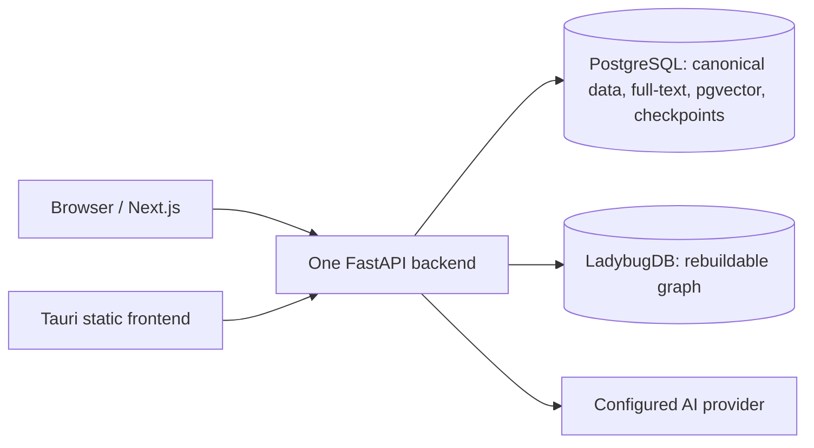

# Angmoo public architecture

This describes the local 0.1.4 source. Formal release and device certification
are separate evidence layers; it does not describe a hosted angmoo.com service.

## Supported topology

Docker uses three services: frontend, backend and PostgreSQL. ARM64 Termux uses
their filesystems through PRoot, without a Docker daemon. Windows x64 bundles
its own PostgreSQL 17 / pgvector resources beside the sidecar. It does not use
a developer's PostgreSQL installation or register a global Windows DB service.
See the [runtime contract](postgresql-runtime.md).

## Ownership and transaction flow

Routes parse HTTP and resolve authentication. Domain services own authorization,
World boundaries, business decisions and state transitions. Same-owner
persistence files implement SQL. Runtime composes workers and cross-domain
collaboration; domain services do not import runtime or bypass another owner.

PostgreSQL is canonical. LadybugDB can be rebuilt from committed projection
events. The API, scheduler and projector run in one backend process. DB work
uses short transactions; no connection is held while waiting for an AI reply.
Retryable conflicts repeat the complete bounded DB transaction, with delayed
results and idempotency records preserved. A retry must not repeat a public
action or a completed AI request.

Memory and relationship maintenance share one execution slot. The selected
character's prepared run/request proceeds continuously at safe commit boundaries;
other maintenance waits while Chat, SNS, search and status remain usable.
Embeddings keep the batch-of-20 contract. Failed closed work remains history
and is excluded from future automatic work. Users can retry remaining work or
finish without retry; completed results remain committed.

Chat/SNS use the accepted start input and stored original snapshots. Relationship
review groups situation-memory bodies by counterpart and supplies only those
bodies and the current perception. It does not reload original source content.
Ownership, deletion, lease/fencing and duplicate/conflict checks still apply.

## Runtime profiles and schema

- `CONTRIBUTOR_POSTGRESQL`: browser / Docker / Termux composition.
- `LOCAL_POSTGRESQL`: installed Windows sidecar with launch-token authorization.
- `TEST`: explicit isolated stores or fakes. Legacy embedded profiles exist for
  SQLite input compatibility; they are not the 0.1.4 service entrypoint.

Profiles are typed at the composition root. Invalid database identities,
privileged runtime roles or mismatched schema versions fail closed. SQLite 41
is a frozen 0.1.3 migration-input contract; PostgreSQL schema v5 is a different
version series. Historical hosted Alembic revisions are not the local PG chain.
See [Backend Architecture](../../backend/ARCHITECTURE.md),
[migration](postgresql-migration.md), and [backup](postgresql-backup.md).

## Providers, privacy and public boundaries

Concrete adapters own SDK access; code owns allowed scope, deterministic
preparation, result validation and persistence. Fake providers cover CI.
`app/domains/identity/service/credential_resolution.py` owns credential
resolution. Plaintext is revealed only at the request boundary. Logs and read
responses contain safe codes, IDs, fingerprints or booleans.

Local authenticated encryption preserves `local-v2` keys and supported `dev-v1`
reads with the original secret. Hosted `oci-kms-v1:` records are preserved but
cannot be used as local credentials. Never replace keys to hide an unsupported
record. Keep Origin, Host, owner and launch-token checks enabled.

Public code includes the local runtime, migrations and synthetic tests. It
excludes credentials, personal DBs, backups, raw logs, private World Packages
and hosted infrastructure. Generated OpenAPI remains the REST contract.
Frontend ownership follows [ARCHITECTURE](../../frontend/ARCHITECTURE.md) and
[DESIGN](../../frontend/DESIGN.md). English documents and fixed AI instructions
remain canonical; user-facing copy has matching Korean translations.
