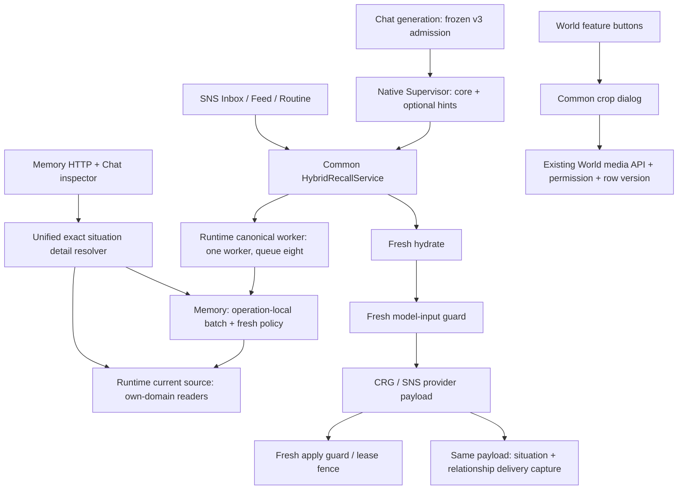

# 2026-10-11 Chat·상황기억·World 통합 구현과 검증 결과

상태: I00–I79 통합 구현·관련 자동 검증 완료. 로컬 변경만 수행했으며, 커밋 근거는 아래 종료 기록으로 보완한다. 실제 모델 품질, 사용자 직접 확인, 설치 앱, PR/CI/main은 별도 미실행이다.

## 실행 범위와 보존

- 제품 저장소: `D:/project_code/angmoo-workspace/angmoo-tree-angmoo`.
- 브랜치: `feat/0.1.0-release-readiness`; 시작 HEAD `3e306c18b50e06b4794f2e5a954e54c5def7ab41`, working tree clean.
- workspace AGENTS와 backend/frontend ARCHITECTURE, frontend DESIGN 및 관련 책임·보존 지침을 적용했다. 소유 경계를 우회하는 ORM export, 새 authorization cache, validation 강제 PASS, allowlist 추가는 없다.
- 합성 SQLite/가짜 공급자/브라우저 API fixture만 사용했다. 원본 World·대화·기억·키·예약과 기존 Docker container/volume/설치 데이터는 변경하지 않았다.
- 설치 앱 진단을 수행하지 않았으므로 Windows 설치 파일·DB의 실제 위치나 실행 버전에 관한 주장은 없다.
- 전체 backend/frontend suite, 원격 CI, push, PR, main merge, 유료 AI/임베딩 호출을 수행하지 않았다. 정적 화면 검증을 위해 수정 소스의 static build/TypeScript 컴파일은 수행했다.
- Next 3380의 기존 개발 서버를 재사용하고 합성 API를 차단 fixture로 연결했다. 정적 3385는 이번 시험용이다. 원본 API로 우회되지 않도록 미등록 요청도 fixture에서 거절한다.

원계획은 수정하지 않았고 다음 원문 revision을 사용했다.

| 원계획 | SHA-256 |
| --- | --- |
| A: 10-11 Chat 관계 쌍 요구 제거와 인물 보조 정보·응답 차단 해소 코드 구현 세부 계획.md | `85686193beafef1b1d37645c64e6c1a4781aeb4d22bba7a0642c357ab4676230` |
| B: 10-11 Chat·SNS 상황기억 연결 재사용과 검색 검증·시간초과 개선 코드 구현 세부 계획.md | `88f6f4dda0551e9fb47a3ac6be5337b9022f279409722281d539b585b9b65f66` |

## 실제 책임과 소비 경로

신규 계약은 `selection-args.hybrid.v3` / `hybrid-admission.v3` / `person-hints.v1`이다. 인물 이름은 보조 자료이며 독립 검색문·scope·rank·권한을 바꾸지 않는다. 아래는 구현과 자동 검증의 실제 범위다.

### Chat

`entities` 항목은 mention과 nullable role이다. 최대32항목에서 160자 이하 이름을 최대4명 전달한다. 비정상 항목은 제외하고 잘못된 role은 null, 중복은 결정적으로 통합한다. 현재 frozen participant payload가 실제 제공하는 requester/responder 이름만 비교하고 나머지는 `not_checked`다. World roster·추가SQL·번역/음차 자동 연결은 추가하지 않았다.

첫 호출의 관계 쌍/ref와 CRG `requested_direction` 요구를 신규 v3에서 제거했다. core가 정상인 경우 보조 정보만으로 repair/실패를 발생시키지 않는다. 원래 질문·독립 search_text·실제 참가자·허용된 문맥은 유지된다. 기존 role 단일 정의, first-person/quotation·사실·불확실성·persona 지침을 재사용하고 영어 지침의 제거 대상만 교체했다. 상황 설명의 `memory_search_locale`는 바꾸지 않았다.

v1/v2의 schema/hash/재개 의미는 유지된다. 보존 identity가 있는 명시적 retry 버튼은 새로운 v3 attempt를 만들고, pending/idempotency는 원래 marker를 읽는다. identity 없는 역사는 현재 profile로 추정하지 않는다. Supervisor/CRG provider await 전에 caller read UoW checkpoint가 실제로 실행되며, 한 최종 payload가 두 delivery capture에 사용된다.

### Memory와 Runtime

한 읽기 operation의 Session/now에만 Memory item/evidence/상황 원본/receipt/manifest/binding/prior와 Runtime current-source 사실을 batch·memo로 재사용한다. SQLite bind를 400개씩 나눈다. current path cycle 검사를 memo보다 먼저 하고, 각 prior의 private/current version/만료·삭제 제한은 계속 적용한다. candidate, hydrate, 모델 입력 전 guard, 모델 후 적용 guard 및 다음 요청은 새 검증이다. 순위/최대50/packet 예산/최종 원문·작성자 metadata를 유지한다. time 판정은 실제 canonical 경험 시각과 legacy multi-source 범위를 기준으로 하므로 representation 메타데이터 확인 뒤 판정하는 경로를 유지한다.

Memory는 자기 ORM을 읽고 Runtime source batch는 Post/Reply/Message/Thread/관계·활동·이미지 등의 자기 소유 조회를 조합한다. port에서만 협력하며 새 source-batch 순환 의존은 query factory 주입으로 제거했다. 실제 embedded factory의 pool checkout `0.05s`는 그대로다.

동기 canonical revalidate/hydrate는 worker 1개·capacity 8의 Runtime queue 안에서 Session을 연다. queue/semaphore 대기를 포함한 절대 deadline을 재설정하지 않는다. SQLite progress handler/최대50ms busy 정책과 취소 신호를 worker-owned connection에 적용하고 finally에서 hook/PRAGMA 복원·rollback·close한다. running 작업의 소유권을 유지하며 admission close → signal cancel → drain → engine dispose 순서다. 저장/vector/Media 큐나 공용 pool 설정은 바꾸지 않았다.

진단은 worker의 불변 receipt만 parent task에 합쳐 공개한다. 관측된 SQL/time/unique/memo/cleanup과 stage만 전달하고 미수집 수치는 null이다. worker 내부 Session, SQL/bind, 이름 원문, body/키/사적 ID는 export하지 않는다.

### 기억 상세

상황 item·정정 계보·entry ordinal·nullable evidence·source/digest/range·scope를 exact 연결하고 item 전체 접근을 먼저 검사한다. HTTP와 Chat inspector는 같은 resolver를 사용하고 위쪽 상황 원문/아래 근거 카드가 한 source 판정을 공유한다. 다음 요청에는 재검사한다. 유효한 Inbox delivery만 있어도 허용된 원문을 표시하지만, 다른 item/범위 proof 차용과 손상 origin의 legacy fallback은 거절한다. Memory OFF는 owner 상세와 recall 계약을 구분한다. POST/REPLY만 canonical World 원문 href를 가지며 분량 생략과 unavailable은 별개다.

### World와 작성 안내 C

기기 홈 아이콘 아래와 World 배너 우상단의 semantic `Button type=button`이 동기 파일 선택을 연다. 현재 URL에서 crop 적용/취소를 완료한다. 새 World 최초 초안 저장의 정상 전환은 유지한다. 처음 보고된 원본 페이지 이동 원인은 실제 원본 쓰기로 재현하지 않았으며, 이미지 선택 코드 자체에 route 변경이 없음을 확인했다. 합성 fixture의 실제 chooser에서 이동/submit 0을 검증했다.

이미지 적용은 기존 icon/banner API 한 번, 취소는 0번이다. 이름/소개/태그를 서버의 오래된 definition으로 덮지 않는다. 409에서는 crop/본문을 보존하고 명시적으로 현재 이미지 상태를 refresh한 뒤 재적용한다. transport 실패/remove/같은 파일 재선택/런타임 전환의 abort·epoch·bitmap 정리를 확인했다. 5MiB PNG/JPEG/WebP, icon 768×768/banner 1024×384 WebP와 default/fallback·한 열 preview를 보존한다. 공통 crop은 recovery-action slot만 확장했고 profile 회귀도 수행했다.

- Feed 본문: **본문을 적어주세요 / Write your post.**
- 제목: 기존 **오늘 이 World에 남길 이야기의 제목을 적어주세요 / Give today's World story a title** 유지.
- Feed/Chat 고정 20MB 원본 설명 문단만 제거. 실제 20MB 원본/10MB 최종 첨부 정책, preparation/recognition/busy/error/취소·사진 버튼은 보존.
- World 업로드/저장 안내 및 원문 조회 진단 문구는 ko/en 동시 반영.

## 검증 결과와 경계

같은 시험의 재실행 숫자를 합산하지 않는다. 다음은 서로 다른 검증 묶음이며 일부 node는 겹친다.

| 검증 묶음 | 결과 | 직접 근거 |
| --- | --- | --- |
| Chat/Memory/runtime 관련 22개 파일의 회귀 | 227 passed, 1 failed, 6 skipped; 실패한 공유 lineage 비용 기대값은 새 계약에 맞춰 고유23node와 각 node restriction을 확인하도록 보완 후 아래 재검증 통과 | 실행 출력; lineage 반복 원문 query 23회 기대가 새 operation-local 1회와 충돌 |
| 마지막 Memory/Runtime 8개 파일 | **44 passed, 6 skipped** | `artifacts/chat-memory-world-20261011/backend-final-read-regression.xml` |
| cheap filter 이유 보존·lineage·episode 3개 파일 | **15 passed** | `artifacts/chat-memory-world-20261011/batch-filter-final.xml` |
| 6 SNS recall + 1 Chat 대표 worker/가벼운 읽기·World icon/banner 권한/CAS/archive | **3 passed** | `artifacts/chat-memory-world-20261011/focused-preservation-final.xml` |
| 기존 World banner round trip/private 권한/commit 실패 보상 | **3 passed** | `artifacts/chat-memory-world-20261011/world-api-final.xml` 의 해당 3 nodes |
| 기존 World lifecycle 종합 node | **기존 실패**; 이미지 처리 뒤 RecommendationPreparation 부재. 변경 전 HEAD archive도 같은 NoResultFound | `test_creator_route_lifecycle_and_stable_conflict`; 현재 CAS/icon/archive는 위 별도2nodes로 검증 |
| 격리 Docker 최종 큰 묶음 | **120 passed, 6 skipped**, 121.62s | network none/read-only source/tmpfs DB; 실제 Runtime factory·FTS·worker 포함 |
| 마지막 변경 및 추가된 대표 큐·World HTTP의 Docker 관련 묶음 | **10 passed**, 37.49s | 같은 격리 image의 `test_canonical_worker.py`, `test_hybrid_recall.py`, `test_world_media_preservation.py` |
| Next/static World/Feed/Chat/profile 및 첨부 회귀 | 서로 다른 **54개 사례 통과**; 한 초기 22묶음의 4개 strict locator 실패는 World 카드로 범위를 좁혀 재검증 | 18 기존 성공 + 20 추가 성공 + 4 runtime scope + 4 transport/remove + 8 new World guard/error/first save. crop4 재실행은 합산하지 않음 |
| World transport/remove+crop 묶음 | **8 passed**, 24.9s | ko/en × Next/static; crop4 재실행 합산0 |
| 최종 새 World image guard/field error/첫 초안 저장 | **8 passed**, 13.4s | 최종 `browser-results.json`; ko/en × Next/static, create1/image0·정상 편집 주소 전환 |
| 진단 export Node | **6 passed** | `frontend/scripts/test-chat-diagnostics.mjs` |
| 관련 ESLint | errors/warnings 0 | 수정한 8개 frontend 파일만 |
| locale | **16 namespaces, 2598 source keys parity** | `frontend/scripts/check-ui-catalog.mjs` |
| Python compile | **46 변경 파일 통과** | `py_compile` 변경 소스/시험만 |
| static build/TypeScript | 성공, exit 0 | `pnpm build:static`의 실제 수정 소스 산출물; Next dev와 static3385 두 소비자 확인 |
| frontend architecture/design | 통과; 14 features, legacy edges 0; raw color1157/35files, surfaces18, screenshot calls55 | 기존 checker; canonical PNG11개/visual tolerance 변경0 |
| backend architecture | **새 위반0**, 전체 검사에는 시작 HEAD의4원인/6메시지가 그대로 남음 | [구조 차이 JSON](architecture-delta-20261011.json) |
| refactor frontend preservation | 두 intentional placeholder expectation 변경을 정확히 기록. package/lock의 이전 freeze 차이 2개는 현 변경이 아님 | 두 test body만 한 문장 교체; dependency 수정0; 종료 provenance 기록 참조 |

6개의 native Vec1 시험은 Windows/Docker 모두 `real Vec1 extension build not supplied`로 skip됐다. 이를 벡터 native 성공으로 표시하지 않는다. 실제 FTS child + file SQLite + production MemoryHybridRuntime의 async canonical 조립은 별도로 통과했다. fake axis 회귀는 FTS/vector 순위·scope·partial/unavailable 의미를 확인한다.

기존 backend 구조 위반은 Chat→Memory/Relationships deep import 2개와 Identity credentials/Memory situation contracts cycle 2개다. stale tracked inventory 대신 실제 시작 HEAD에서 AST를 재생성하여 같은 위반임을 확인했다. 현재 inventory도 실제 소스로 갱신했으며 예외를 추가하지 않았다. 따라서 전체 backend architecture PASS를 주장하지 않는다. 기존 frontend dependency freeze 불일치도 수정/allowlist 하지 않았다.

World390px rendered screenshot을 직접 확인했고, 360/390/768/1440의 순서·overflow·default/fallback/긴 이름·소개·태그는 브라우저에서 검사했다. 자동 화면 회귀는 설치 앱/모바일 물리 기기/사용자 직접 확인 PASS가 아니다.

## 성능 측정

동일한 실제 저장 합성 기억50개가 공개 post1개와 prior1개를 공유한다. 시작 HEAD를 별도 archive로 읽고 같은 cost probe를 복사하여 warm-up1회 후5회 중앙값을 순차 측정했다. rank/version/scope와 SQL event counting은 같다. provider·원본 DB는 사용하지 않았다.

| 경계 | 전 SQL → 후 SQL | 전 median ms → 후 median ms | 판독 |
| --- | --- | --- | --- |
| 후보1 | 24 → 32 | 11.892 → 14.04 | 고정 batch 비용 약2ms 증가; 15s 예산에 대한 절대 지연은 작지만 모든 작은 읽기가 빨라졌다고 주장하지 않음 |
| 후보10 | 195 → 32 | 113.57 → 20.404 | SQL/시간 감소 |
| 후보50 | 955 → 32 | 527.106 → 43.532 | SQL 96.65% 감소; 시간91.74% 감소, 목표 충족 |
| HTTP 상세 전체 | 59 → 44 | 31.807 → 21.436 | SQL/시간 감소 |

50 후보의 고유 검증 node는51(상황50 + prior1), memo hits49다. 후보1/10의 고유 node는2/11, hits0/9다. worker 관측의 미측정 값을 0으로 채우지 않는다. 최종 guard도 독립 operation-local context를 사용하므로 candidate의 허용 판정을 넘겨 권한 검사를 생략하지 않는다. 상세 SQL은59→44로 증가 없음 조건을 충족했다. 비용 JSON은 [before](canonical-cost-before-20261011.json), [after](canonical-cost-after-20261011.json).

## V00–V31 coverage

아래 PASS는 해당 범위의 자동 계약 검증이며 전체 모델 품질이나 전역 gate PASS가 아니다. 관련 test node를 재사용했다. Vec1 native 환경 제외, 기존 전역 위반은 위 제한을 적용한다.

| 범주 | 결과 | 실제 근거 |
| --- | --- | --- |
| V00–V03 | PASS | advisory_person_hints: native3종 × malformed8개, core negatives, bounds, 실제 generation fake Supervisor1/CRG1와 요청/범위 보존 |
| V04–V06 | PASS | hybrid canonical guards, situation proof/parent/recovery, episode privacy/lineage/restriction negative, next-operation source mutation |
| V07–V10 | PASS | named_selection_lifecycle, existing intent/binding/prompt regressions, v3 실제 generation/checkpoint와 localeKO 보존 |
| V11–V12 | PASS | closed decision fields, bounded canonical receipts, Node export6, direct hint routing person lookup0, compile/import 신규 위반0 |
| V13–V15 | PASS (native6 환경 제외) | episode/hybrid/packet/proof/application/recheck/recovery 관련 파일, SNS fresh revalidation/parent binding |
| V16 | PASS | shared-source cost before/after; warm1+median5, 1/10/50/detail |
| V17–V19 | PASS | real SQLite recursive progress interrupt·exclusive lock·heartbeat·capacity/cancel/drain/reuse·7요청 대표 묶음 |
| V20 | PASS | 실제 MemoryHybridRuntime+FTS factory, 실제 Chat workflow/new v3, SNS common recall/final guard 조립과 lane 회귀 |
| V21–V23 | PASS | situation_detail_unified: 정상 Inbox-only/MemoryOFF, 타scope/원문수정, nullable/range/damaged-origin; existing inspector/correction/packet 회귀; 상세SQL |
| V24 | PASS (native6 환경 제외) | Docker120 + 마지막 변경10; network0/read-only/tmpfs/same current source |
| V25–V28 | PASS | real filechooser keyboard, same URL/body, crop/dimensions/409/remove/scope, ko/en Next/static widths, C placeholder+첨부 보존 |
| V29 조건부 | 실행/PASS | 공개 canonical diagnostics DTO/UI를 실제 수정; ko/en Next/static4사례와 Node6/legacyunknown/export safe fields |
| V30 조건부 | 실행/PASS | common ImageCropDialog의 recovery slot 수정; 기존 profile avatar/banner 회귀 Next/static |
| V31 선택 | **미실행/미관찰** | 실제 AI/임베딩 호출0. 실제 해석·근거 활용·자연스러움·반복 성공률을 자동 시험에서 추정하지 않음 |

## I00–I79 수행 ledger

원계획 A/B/C와 필요한 V 대응을 원문 그대로 유지한다. 환경 제외/기존 실패는 완료를 숨기는 PASS가 아니라 위 별도 결과다.

| 단계 | 완료 상태 | 원계획 대응 | 필요한 검증 | 구현·확인 근거 |
| --- | --- | --- | --- | --- |
| I00 | 완료 | A:I00, B:I00 | 시작 상태·원계획 hash | 시작 HEAD/원계획 hash·책임 도식·계약·cost before·상태표 |
| I01 | 완료 | A:I00, B:I01 | 적용 지침·V28 | 시작 HEAD/원계획 hash·책임 도식·계약·cost before·상태표 |
| I02 | 완료 | A:I01, B:I02, C | 기존 소비자 목록 | 시작 HEAD/원계획 hash·책임 도식·계약·cost before·상태표 |
| I03 | 완료 | A:I02, B:I03 | 2절 계약·V00/V04 | 시작 HEAD/원계획 hash·책임 도식·계약·cost before·상태표 |
| I04 | 완료 | A:I22, B:I04 | V11 설계 | 시작 HEAD/원계획 hash·책임 도식·계약·cost before·상태표 |
| I05 | 완료 | A:I01 | V00/V07/V11 baseline | 시작 HEAD/원계획 hash·책임 도식·계약·cost before·상태표 |
| I06 | 완료 | B:I05 | V16/V23 baseline | 시작 HEAD/원계획 hash·책임 도식·계약·cost before·상태표 |
| I07 | 완료 | A:I02, B:I06 | V08/V14/V21 설계 | 시작 HEAD/원계획 hash·책임 도식·계약·cost before·상태표 |
| I08 | 완료 | A:I03 | V02/V08 | Chat person_hints/supervisor_selection/retrieval_routing/recall_interpretation·native/advisory/lifecycle/prompt 시험 |
| I09 | 완료 | A:I04 | V01 | Chat person_hints/supervisor_selection/retrieval_routing/recall_interpretation·native/advisory/lifecycle/prompt 시험 |
| I10 | 완료 | A:I05 | V01/V12 | Chat person_hints/supervisor_selection/retrieval_routing/recall_interpretation·native/advisory/lifecycle/prompt 시험 |
| I11 | 완료 | A:I06 | V00/V10 | Chat person_hints/supervisor_selection/retrieval_routing/recall_interpretation·native/advisory/lifecycle/prompt 시험 |
| I12 | 완료 | A:I07 | V00/V02 | Chat person_hints/supervisor_selection/retrieval_routing/recall_interpretation·native/advisory/lifecycle/prompt 시험 |
| I13 | 완료 | A:I08 | V07/V08 | Chat person_hints/supervisor_selection/retrieval_routing/recall_interpretation·native/advisory/lifecycle/prompt 시험 |
| I14 | 완료 | A:I09 | V00/V20 | Chat person_hints/supervisor_selection/retrieval_routing/recall_interpretation·native/advisory/lifecycle/prompt 시험 |
| I15 | 완료 | A:I10 | V01/V02 | Chat person_hints/supervisor_selection/retrieval_routing/recall_interpretation·native/advisory/lifecycle/prompt 시험 |
| I16 | 완료 | A:I11 | V02/V03/V13 | Chat person_hints/supervisor_selection/retrieval_routing/recall_interpretation·native/advisory/lifecycle/prompt 시험 |
| I17 | 완료 | A:I12 | V03/V04/V12 | Chat person_hints/supervisor_selection/retrieval_routing/recall_interpretation·native/advisory/lifecycle/prompt 시험 |
| I18 | 완료 | A:I13 | V04/V05 | Chat person_hints/supervisor_selection/retrieval_routing/recall_interpretation·native/advisory/lifecycle/prompt 시험 |
| I19 | 완료 | A:I14 | V02 | Chat person_hints/supervisor_selection/retrieval_routing/recall_interpretation·native/advisory/lifecycle/prompt 시험 |
| I20 | 완료 | A:I15 | V08 | Chat person_hints/supervisor_selection/retrieval_routing/recall_interpretation·native/advisory/lifecycle/prompt 시험 |
| I21 | 완료 | A:I16 | V03/V08/V14 | Chat person_hints/supervisor_selection/retrieval_routing/recall_interpretation·native/advisory/lifecycle/prompt 시험 |
| I22 | 완료 | A:I17 | V10 | Chat person_hints/supervisor_selection/retrieval_routing/recall_interpretation·native/advisory/lifecycle/prompt 시험 |
| I23 | 완료 | A:I18 | V03/V10 | Chat person_hints/supervisor_selection/retrieval_routing/recall_interpretation·native/advisory/lifecycle/prompt 시험 |
| I24 | 완료 | A:I19 | V10 | Chat person_hints/supervisor_selection/retrieval_routing/recall_interpretation·native/advisory/lifecycle/prompt 시험 |
| I25 | 완료 | B:I07 | V13 | Memory access_batch/access_validation/episode_privacy·Runtime situation_source_batch·packet/fresh guard/lineage 회귀 |
| I26 | 완료 | B:I08 | V05/V06/V16 | Memory access_batch/access_validation/episode_privacy·Runtime situation_source_batch·packet/fresh guard/lineage 회귀 |
| I27 | 완료 | B:I09 | V06/V16 | Memory access_batch/access_validation/episode_privacy·Runtime situation_source_batch·packet/fresh guard/lineage 회귀 |
| I28 | 완료 | B:I10 | V04/V05/V16 | Memory access_batch/access_validation/episode_privacy·Runtime situation_source_batch·packet/fresh guard/lineage 회귀 |
| I29 | 완료 | B:I11 | V05/V21/V22 | Memory access_batch/access_validation/episode_privacy·Runtime situation_source_batch·packet/fresh guard/lineage 회귀 |
| I30 | 완료 | B:I12 | V04/V05/V13 | Memory access_batch/access_validation/episode_privacy·Runtime situation_source_batch·packet/fresh guard/lineage 회귀 |
| I31 | 완료 | B:I13 | V14 | Memory access_batch/access_validation/episode_privacy·Runtime situation_source_batch·packet/fresh guard/lineage 회귀 |
| I32 | 완료 | B:I14 | V08/V14/V16 | Memory access_batch/access_validation/episode_privacy·Runtime situation_source_batch·packet/fresh guard/lineage 회귀 |
| I33 | 완료 | B:I15 | V08/V14 | Memory access_batch/access_validation/episode_privacy·Runtime situation_source_batch·packet/fresh guard/lineage 회귀 |
| I34 | 완료 | B:I16 | V04/V05/V09/V14 | Memory access_batch/access_validation/episode_privacy·Runtime situation_source_batch·packet/fresh guard/lineage 회귀 |
| I35 | 완료 | B:I06, B:I11 | V21/V22/V23 | Runtime situation_detail·Memory inspector/situation_packets·HTTP/Chat composition·detail unified/negative/SQL |
| I36 | 완료 | B:I13, B:I14 | V21/V22 | Runtime situation_detail·Memory inspector/situation_packets·HTTP/Chat composition·detail unified/negative/SQL |
| I37 | 완료 | B:I14 | V21/V23 | Runtime situation_detail·Memory inspector/situation_packets·HTTP/Chat composition·detail unified/negative/SQL |
| I38 | 완료 | B:I17 | V09/V17 | canonical_worker/hybrid_runtime·async port·SNS whole deadline·generation checkpoint·real factory/worker/diagnostic export |
| I39 | 완료 | B:I18 | V17/V19 | canonical_worker/hybrid_runtime·async port·SNS whole deadline·generation checkpoint·real factory/worker/diagnostic export |
| I40 | 완료 | B:I19 | V18 | canonical_worker/hybrid_runtime·async port·SNS whole deadline·generation checkpoint·real factory/worker/diagnostic export |
| I41 | 완료 | B:I19 | V18/V19 | canonical_worker/hybrid_runtime·async port·SNS whole deadline·generation checkpoint·real factory/worker/diagnostic export |
| I42 | 완료 | B:I20 | V19 | canonical_worker/hybrid_runtime·async port·SNS whole deadline·generation checkpoint·real factory/worker/diagnostic export |
| I43 | 완료 | A:I21, B:I17, B:I22 | V09 | canonical_worker/hybrid_runtime·async port·SNS whole deadline·generation checkpoint·real factory/worker/diagnostic export |
| I44 | 완료 | B:I21 | V11/V17 | canonical_worker/hybrid_runtime·async port·SNS whole deadline·generation checkpoint·real factory/worker/diagnostic export |
| I45 | 완료 | B:I22 | V20 | canonical_worker/hybrid_runtime·async port·SNS whole deadline·generation checkpoint·real factory/worker/diagnostic export |
| I46 | 완료 | A:I22, A:I23, B:I04, B:I21 | V11 | canonical_worker/hybrid_runtime·async port·SNS whole deadline·generation checkpoint·real factory/worker/diagnostic export |
| I47 | 완료 | A:I24 | V07/V08 | generation v3 marker/retry·최종 payload capture·기존 proof/application/recovery 관련 회귀 |
| I48 | 완료 | A:I25 | V07 | generation v3 marker/retry·최종 payload capture·기존 proof/application/recovery 관련 회귀 |
| I49 | 완료 | A:I26, B:I19, B:I20 | V09/V18/V19 | generation v3 marker/retry·최종 payload capture·기존 proof/application/recovery 관련 회귀 |
| I50 | 완료 | A:I20 | V03/V08/V10/V15 | generation v3 marker/retry·최종 payload capture·기존 proof/application/recovery 관련 회귀 |
| I51 | 완료 | B:I23 | V15 | generation v3 marker/retry·최종 payload capture·기존 proof/application/recovery 관련 회귀 |
| I52 | 완료 | A:I34, B:I29, C | 필수 V28, 진단/근거 변경 시 V29 | Social body ko/en·Media 설명 문단 제거·typed diagnostics·Node/Next/static |
| I53 | 완료 | A:I16, B:I22, B:I27 | V02/V04/V08/V14/V20 | test_advisory_person_hints 실제 generation fake2calls + 실제 Runtime FTS/canonical factory |
| I54 | 완료 | A:I35 | 재현 근거·V25 | World Button/input/crop/state/409 refresh/epoch·creator-copy-ui/profile Next/static·World HTTP scoped tests |
| I55 | 완료 | A:I36 | V25/V28 | World Button/input/crop/state/409 refresh/epoch·creator-copy-ui/profile Next/static·World HTTP scoped tests |
| I56 | 완료 | A:I37 | V25/V28 | World Button/input/crop/state/409 refresh/epoch·creator-copy-ui/profile Next/static·World HTTP scoped tests |
| I57 | 완료 | A:I38 | V26/V28 | World Button/input/crop/state/409 refresh/epoch·creator-copy-ui/profile Next/static·World HTTP scoped tests |
| I58 | 완료 | A:I39 | V26, 조건부 V30 | World Button/input/crop/state/409 refresh/epoch·creator-copy-ui/profile Next/static·World HTTP scoped tests |
| I59 | 완료 | A:I40 | V27 | World Button/input/crop/state/409 refresh/epoch·creator-copy-ui/profile Next/static·World HTTP scoped tests |
| I60 | 완료 | A:I41 | V27 | World Button/input/crop/state/409 refresh/epoch·creator-copy-ui/profile Next/static·World HTTP scoped tests |
| I61 | 완료 | A:I42 | V27 | World Button/input/crop/state/409 refresh/epoch·creator-copy-ui/profile Next/static·World HTTP scoped tests |
| I62 | 완료 | A:I43 | V28 | World Button/input/crop/state/409 refresh/epoch·creator-copy-ui/profile Next/static·World HTTP scoped tests |
| I63 | 완료 | A:I44, A:I45 | V25/V26 | World Button/input/crop/state/409 refresh/epoch·creator-copy-ui/profile Next/static·World HTTP scoped tests |
| I64 | 완료 | A:I46, A:I47, A:I48 | V27/V28, 조건부 V30 | World Button/input/crop/state/409 refresh/epoch·creator-copy-ui/profile Next/static·World HTTP scoped tests |
| I65 | 완료 | A:I27 | V00/V01/V02 | native3함수·8 malformed hints·5 core negatives·32/160/4 경계, 실제 generation hint repair0 |
| I66 | 완료 | A:I28, A:I29, B:I24 | V03/V04/V05/V06/V08/V14 | Chat legacy/hash/identity/prompt + Memory source/prior/packet/final guard 관련 negative 회귀 |
| I67 | 완료 | A:I30, A:I31, B:I27 | V07/V09/V10 | Chat legacy/hash/identity/prompt + Memory source/prior/packet/final guard 관련 negative 회귀 |
| I68 | 완료 | A:I32, B:I25 | V12/V16 | canonical-cost before/after median5·955→32SQL·hint 추가SQL/paid call0 |
| I69 | 완료 | B:I26 | V17/V18/V19 | test_canonical_worker 5nodes + 실제 factory; recursive SQL/lock/7요청 heartbeat/stop/drain |
| I70 | 완료 | B:I23, B:I24, B:I27 | V06/V15 | situation proof/application/recheck/recovery·lineage/cycle/private/legacy 회귀 |
| I71 | 완료 | B:I25, B:I27 | V21/V22/V23 | situation_detail_unified + existing inspector/packet; 전체 상세59→44SQL |
| I72 | 완료 | A:I33, B:I28 | 필수 V24 | 격리 Docker120pass + 마지막 변경10pass/native6환경skip; 원본 volume0변경 |
| I73 | 완료 | A:I34, B:I29, C | 필수 V28, 진단/근거 변경 시 V29 | 필수 C ko/en Feed/Chat·Next/static·첨부 준비/busy/error/cancel + 진단4UI/6Node |
| I74 | 완료 | A:I48, A:I49, B:I29, C | V12/V28/V11 | 46Python compile·8파일ESLint·catalog2598·static build/type·frontend architecture/design·backend delta 신규0 |
| I75 | 완료 | A:I50, B:I30, C | 문서·검증 결과 | backend/frontend ARCHITECTURE·DESIGN·refactor preservation append·이 결과 문서 |
| I76 | 완료 | A:I50, B:I30 | 13절 복구 근거 | 아래 데이터 보존 rollback/drain/v3 admission compatibility 절차; 운영 실행0 |
| I77 | 완료 | A:I51, B:I30, C | coverage ledger | 80개 연속 번호·A I00–I53/B I00–I31와 V 원번호 coverage 자동 점검·C/조건부/미관찰 분리 |
| I78 | 완료 | A:I52, B:I31 | commit SHA·선택 파일 | 현재 branch 선택 stage·로컬 commit만; 종료 commit/provenance 기록 참조 |
| I79 | 완료 | A:I53, B:I30, B:I31, C | 최종 상태 | 최종 보고: 구현/자동/Docker/환경skip/실제AI·USER CHECK/PR·CI·main 분리 |

## 데이터 reset 없는 복구

1. 신규 recall admission/producer를 정상 종료로 닫고 진행 중 worker를 cancel/signal/drain한 뒤 engine을 dispose한다. 다른 thread에서 Session을 닫거나 공유 연결을 임의 interrupt하지 않는다.
2. v3 admission/interpretation을 읽을 수 있는 소스를 유지한다. v3 기록이 만들어진 뒤 v3 미지원 구형 binary만 되돌리는 downgrade는 하지 않는다. 필요하면 v3 decoder/marker 호환을 유지하면서 변경된 executor/UI만 고친다.
3. SQLite canonical item/receipt/manifest/source binding·대화·SNS·설정/키는 보존한다. 임시 DB·전체 기억 reset/backfill로 정상 proof를 위장하지 않는다.
4. FTS/vector/graph derived projection 문제가 확인된 경우에만 기존 replay/rebuild 기능을 해당 projection에 사용한다. 이 구현에서 전체 색인을 재생성하지 않았다.
5. World media API/schema/storage는 변경하지 않았다. UI rollback도 row_version/편집 권한/실제 저장 이미지·정의는 유지한다. C의 placeholder 변경과 안내 삭제는 정책 rollback 대상이 아니다.
6. 실제 배포·재시작·원본 설정 변경은 이 실행 범위에 포함하지 않았다. 설치 앱 관련 후속 진단은 AGENTS의 물리 설치 identity 확인부터 시작한다.

## 남은 관찰과 기존 부채

- 실제 AI를 사용한 질문 해석/remembered source 활용/표현 품질은 미관찰. 유료 호출을 자동 검증이나 성공 주장에 포함하지 않았다.
- native Vec1 binary를 준비한 환경에서 skip6을 별도로 실행할 수 있다. 이번 작업에서는 설치/CI를 추가 실행하지 않았다.
- 기존 구조4원인 및 World 추천준비 기대값/이전 dependency freeze는 별도의 기존 부채다. 이번 변경이 이를 고쳤다고 말하지 않는다. 기능 실패를 validation PASS/새 allowlist로 숨기지 않았다.
- 사용자 원본 World에서의 직접 이미지 편집/실제 모바일·설치 앱 USER CHECK는 미실행이다.
- 원계획과 사용자 기존 이력, 원본 container/volume/data, 기존 Next 서버는 보존한다.

## 로컬 종료 기록

- 구현 커밋: `618096aee7d27af4efc3f0d646d68e59b6d512a1` (`fix(chat): decouple advisory hints and bound canonical memory reads`), 변경 파일79개를 명시 선택했다.
- 후속 증거 커밋은 새 World guard/첫 저장의 관련 시험8개와 시험 수집 범위를 보완하고, 이 구현 커밋의 정확한 Git blob/SHA를 이용해 두 Feed 기대값만 append-only `post_refactor_contract_changes.json`에 등록하고 이 종료 기록을 보완한다. 커밋의 자기 SHA를 파일 안에 추정해 쓰지 않으며 `git log -2`로 실제 최종 커밋을 확인한다.
- 두 기존 기대값은 approved placeholder 한 문장 외 변경0이며, PNG/visual tolerance/dependency 변경0을 확인했다. 전역 dependency freeze의 package/lock 두 이전 불일치는 그대로다.
- 원계획 A/B hash는 보존하고 workspace 통합 계획의 상태/80단계 ledger 링크만 갱신했다.
- I78 로컬 선택 commit, I79 구현·자동 검증·Docker·제한/미관찰 분리 보고로 종료한다. 외부 Git 작업은0이다.
