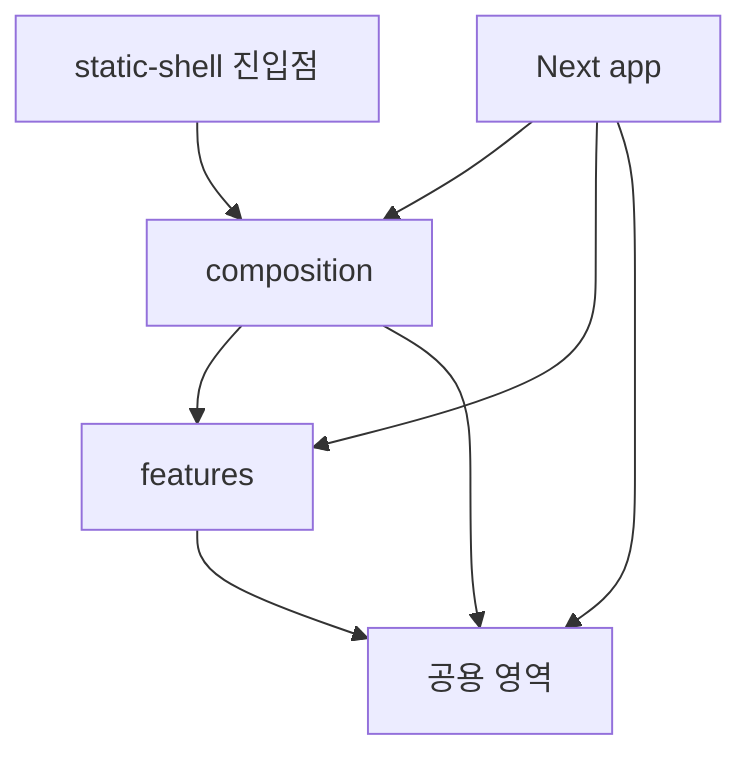

# Angmoo 프론트엔드 아키텍처

[English](ARCHITECTURE.md) | 한국어

Angmoo 프론트엔드는 **기능을 중심으로 코드를 묶고, 여러 기능의 협력은 상위 화면에서
조립하는 구조**이다. 이 문서는 새 기능이나 오류 수정의 위치·역할·의존 방향을 설명한다.
화면의 시각적 표현과 상호작용 기준은 [DESIGN.md](DESIGN.md)에 정의한다.

이 구조는 [Bulletproof React의 구조 가이드](https://github.com/alan2207/bulletproof-react/blob/master/docs/project-structure.md)와
[Next.js App Router 예제](https://github.com/alan2207/bulletproof-react/tree/master/apps/nextjs-app)를 참고했다.
Angmoo는 기능을 `features`, 제품 화면 조립을 `composition`, 공용 코드를
`assets/components/config/hooks/lib/stores/styles/types/utils`로 구분한다.

## 참고 구조를 Angmoo에 적용한 방식

| 참고 원칙 | Angmoo의 대응 | 그대로 가져오지 않는 부분 |
| --- | --- | --- |
| 기능별 구성 | `src/features/chat`, `memory`, `social` 등에서 기능 요청·표시·상태를 소유 | 모든 코드를 공용 component·hook에 모으는 방식 |
| 기능 협력은 상위에서 조립 | `composition/screens`가 서로 다른 기능의 callback·slot을 연결 | feature끼리 직접 import하거나 역으로 화면을 참조하는 연결 |
| 공용 코드와 기능 코드의 단방향 의존 | 화면이 기능을, 기능이 공용 코드를 사용함. import 방향은 화면 → 기능 → 공용 영역 | 제품 중립 primitive 안의 World·권한·provider 결정 |
| 직접 파일 import와 필요한 폴더만 생성 | 실제 역할 파일을 import; 선택적인 `assets`·`stores`·테스트 지원 | 모든 feature의 barrel export·빈 폴더·상태 라이브러리 의무화 |
| App Router의 진입점 구분 | `app`이 Next route·layout·서버 연결을 소유 | 설치 앱에 요청 시 Next 서버가 있다고 가정하는 코드 |

`composition`은 Angmoo가 Next 웹과 static/Tauri에서 같은 화면을 사용하기 위해 선택한
추가 배치이다. 참고 프로젝트의 도구 목록을 복사하는 것이 아니라 기존의 통신·상태·
Playwright 검사와 native 연결을 유지한다.

## 목차

- [현재 프로젝트 구조](#현재-프로젝트-구조)
- [현재 기능별 소유권](#현재-기능별-소유권)
- [기능 안에서 코드 나누기](#기능-안에서-코드-나누기)
- [화면 조립과 의존 방향](#화면-조립과-의존-방향)
- [웹과 설치 앱에서 같은 화면 사용하기](#웹과-설치-앱에서-같은-화면-사용하기)
- [API와 상태의 소유권](#api와-상태의-소유권)
- [현재 기능의 상태와 자원 수명](#현재-기능의-상태와-자원-수명)
- [공용 UI와 디자인](#공용-ui와-디자인)
- [테스트 지원과 실행 위치](#테스트-지원과-실행-위치)
- [기능 추가와 버그 수정](#기능-추가와-버그-수정)
- [경계 검사와 검증 선택](#경계-검사와-검증-선택)
- [설계 근거와 관련 문서](#설계-근거와-관련-문서)

## 현재 프로젝트 구조

아래 트리는 현재 추적되는 주요 경로다. 생략한 파일은 각 소유자의 실제 트리에서 확인한다. 아직 없는 공용 `stores`·`testing`과 기능별 선택 폴더는 별도 표에서 설명하며, 현재 경로인 것처럼 섞지 않는다.

```text
angmoo/
├── frontend/
│   ├── public/                     # URL로 직접 제공하는 정적 파일
│   ├── src/
│   │   ├── app/                    # Next.js route·layout·metadata·웹 진입점
│   │   ├── assets/                 # 현재 로컬 Quicksand 폰트 등 소스 자산
│   │   ├── composition/            # 여러 기능의 화면 조립
│   │   │   ├── screens/            # 웹·정적 실행이 공유하는 화면
│   │   │   ├── shells/             # Device·World·Studio 화면 틀
│   │   │   ├── providers/          # 인증·native·PWA 연결 조립
│   │   │   ├── navigation/         # 제품 탐색 toolbar
│   │   │   ├── locales/            # 조립 화면의 한영 문구
│   │   │   └── static-product-router.tsx
│   │   ├── features/
│   │   │   ├── device-home/
│   │   │   ├── characters/
│   │   │   ├── creator-studio/
│   │   │   ├── social/
│   │   │   ├── relationships/
│   │   │   ├── world-packages/
│   │   │   ├── chat/
│   │   │   ├── memory/
│   │   │   └── ...
│   │   ├── components/             # 제품 중립적인 공용 UI
│   │   ├── config/                 # 환경·실행 환경 설정
│   │   ├── hooks/                  # 공용 React hook
│   │   ├── lib/                    # 공용 통신·탐색·데스크톱 연결
│   │   ├── styles/                 # 필요한 공통 스타일
│   │   ├── types/                  # 여러 기능이 공유하는 타입
│   │   ├── utils/                  # 공용 순수 보조 함수
│   │   └── proxy.ts                # Next 서버의 공통 요청 보안 경계
│   ├── static-shell/               # 설치 앱용 정적 Next 앱 진입점·설정
│   ├── scripts/                    # 정적 빌드·preview·Node 검증
│   ├── ARCHITECTURE.md
│   ├── DESIGN.md
│   ├── AGENTS.md
│   ├── package.json
│   ├── pnpm-lock.yaml
│   ├── next.config.ts
│   ├── tsconfig.json
│   └── eslint.config.mjs
├── browser-tests/                  # Playwright 시나리오·설정·브라우저 fixture
└── desktop/                        # Tauri 창·native bridge·설치 앱 지원
```

`app`은 URL과 Next.js에 관한 책임을 가진다. `composition`은 Chat과 Memory처럼 서로 다른 기능을 한 화면에 연결한다. `features`는 각 기능의 화면·데이터 요청·상태를 소유한다. 공용 영역에는 World나 Character 같은 특정 업무를 알아야만 동작하는 코드를 모으지 않는다.

정적 자산은 제공 방식과 소유권에 따라 구분한다.

- `public/`은 Next.js가 URL로 정적 파일을 제공하는 위치다. 예를 들어 `public/images/logo.png`는 `/images/logo.png`로 참조한다. [Next.js의 public 규약](https://nextjs.org/docs/app/api-reference/file-conventions/public-folder)
- `src/assets/`는 소스 코드의 import나 스타일 참조로 사용하는 공용 자산 위치다. 현재 `src/assets/fonts/quicksand/`를 사용한다.
- `src/features/<feature>/assets/`는 같은 방식으로 사용하는 자산 중 해당 기능이 소유하는 것만 둔다.

`assets/`는 Next.js의 특수 폴더 이름이 아니라 자산을 정리하는 관례다. `public/`과 함께 사용할 수 있으며, 어느 한쪽이 다른 쪽을 대체하지 않는다. 기능 전용 파일도 URL로 직접 제공해야 한다면 `public/` 아래에 둘 수 있다. 두 위치를 모두 설명한다고 기존 파일을 옮기거나 같은 자산을 중복 복사하지 않는다.

이들은 저장소가 소유한 배포용 정적 자산의 위치이며, 사용자 업로드나 비공개 media의 저장소가 아니다. `assets/`에 둔다고 비공개가 되는 것은 아니며, 사용자 media는 기존 백엔드 전달·권한 계약을 따른다.

현재 공용 `src/stores/`는 없다. 특정 기능에 속하지 않는 공용 클라이언트 상태를 별도로 관리해야 할 때 선택할 수 있는 위치다. 기능이 소유하는 상태는 `src/features/<feature>/stores/`에 두며, 여러 화면에서 사용한다는 이유만으로 공용 저장소로 옮기지 않는다.

컴포넌트의 지역 상태나 기존 context·hook만으로 충분하면 별도 store를 만들거나 상태 관리 라이브러리를 추가하지 않는다.

예를 들어 클릭 가능한 기본 버튼은 `components`에 속한다. 그 버튼을 눌러 기억을 삭제하고 결과를 갱신하는 부분은 `features/memory`에 속한다. 기억 삭제 권한과 저장소의 삭제 규칙은 [백엔드](../backend/ARCHITECTURE.ko.md)의 책임이다.

파일명은 `world-chat.tsx`, `memory-batch-controls.tsx`처럼 역할을 드러내는 이름을 사용한다. 같은 이름의 거대한 공용 `helpers` 파일로 여러 기능을 합치지 않는다.

### 공용 영역의 구체적인 책임

| 위치 | 책임 | 현재 예시 또는 선택 조건 |
| --- | --- | --- |
| `app` | URL·layout·metadata·Next 서버의 진입 | `app/page.tsx`, `app/memory/page.tsx`, `app/api/` |
| `composition/screens` | 여러 feature를 조립하는 제품 화면 | `world-chat-screen.tsx`, `memory-workspace-screen.tsx` |
| `composition/shells` | 제품 viewport·World·Studio 틀 | `product-viewport.tsx`, `world-app-shell.tsx` |
| `composition/providers` | 인증·환경·native·PWA 수명 연결 | `auth-provider.tsx`, `user-environment-provider.tsx` |
| `components` | 업무를 결정하지 않는 UI·표시·layout | `ui/button.tsx`, `media/post-media-grid.tsx` |
| `config` | 공통 실행·모델 표시·PWA 설정 | `features.ts`, `generation-profiles.ts`, `pwa.ts` |
| `hooks` | 공용 React 자원·탐색·표시 수명 | `use-element-visibility.ts`, `use-runtime-media-url.ts` |
| `lib` | HTTP·인증·runtime·native·i18n·media 연결 | `http/api-request.ts`, `runtime/runtime-config.ts`, `i18n/` |
| `assets` | 소스 참조 공용 정적 자산 | 현재 `fonts/quicksand/`; 원격 폰트를 빌드 중 받지 않음 |
| `styles` | 공통 스타일·semantic token | `globals.css`, `semantic-tokens.css` |
| `types` | 여러 소비자가 공유하는 실제 계약 | `user-environment.ts`; 모든 feature DTO를 모으지 않음 |
| `utils` | 공용 순수 변환 | `class-names.ts`, `safe-navigation.ts` |
| 공용 `stores` | 기능 중립 client 상태가 실제 필요한 경우의 선택 영역 | 현재 없음; 기존 context와 `lib/state/`를 먼저 확인 |
| 공용 `testing` | 여러 테스트의 실제 공용 지원이 필요한 경우의 선택 영역 | 현재 없음; 기존 `browser-tests`·Node 검사에 연결 |

`lib/server`는 웹 서버용 도구를 둘 수 있지만, 공통 화면·Client Component·static 경로가
직접 또는 간접으로 import하면 안 된다. 공용 폴더에 있다는 것과 모든 실행 환경에서
사용 가능하다는 것은 다르다. `proxy.ts`에도 업무별 화면·feature 처리를 넣지 않는다.

## 현재 기능별 소유권

다음은 현재 `features/`에서 확인되는 기능이다. 각 행은 파일 생성 양식이 아니라
문제의 소유자를 찾는 지도다. 기능 목록은 현재 디렉터리와 실제 호출 코드를 기준으로 확인한다.

| feature | 소유하는 기능·상태 | 먼저 볼 현재 경로 |
| --- | --- | --- |
| `identity` | 로그인·Local 세션·사용자 환경 연결 | `api/session.ts`, `controllers/local-entry-controller.ts` |
| `device-home` | World 목록·실행 표면·Home 상태 | `api/device-home-client.ts`, `components/`, `hooks/` |
| `worlds` | World 정의·현재 사용자 membership·삭제 상태 | `api/world-app-client.ts`, `api/world-deletion.ts` |
| `characters` | 캐릭터 생성·프로필·World 캐릭터 설정·활동 표시 | `api/`, `components/`, `stores/`, `utils/` |
| `creator-studio` | 캐릭터·World 제작 화면의 기능 | `components/creator-studio-dashboard.tsx` |
| `social` | Feed·게시물·댓글·반응·알림 | `components/social-post-row.tsx`, `hooks/use-owner-reactions.ts` |
| `chat` | thread·메시지·전송·stream·이전 대화 조회 | `components/world-chat.tsx`, `hooks/use-world-chat-history.ts` |
| `memory` | 기억 조회·정리 설정·근거 inspector | `components/memory-workspace.tsx`, `api/memory-client.ts` |
| `relationships` | 관계 조회·그래프 표시와 기능 상태 | `api/`, `components/relationship-graph-frame.tsx` |
| `media` | 사진 준비·선택·인식·공유 이미지 설정 UI | `components/image-picker.tsx`, `workers/photo-preparation.worker.ts` |
| `runtime-status` | runtime 준비·제한·진단의 표시 | `api/runtime-status-client.ts`, `components/` |
| `world-packages` | World 패키지 검사·내보내기·가져오기 UI와 전달 | `api/world-package-client.ts`, `api/browser-delivery.ts`, `api/native-delivery.ts` |
| `tree` | Tree 게시판의 화면·요청·표시 계약 | `api/`, `components/`, `types/` |
| `support` | API 가이드·라이선스 등 지원 화면·문서 제공 | `api/documents-server.ts`, `components/angmoo-api-content.tsx` |
| `ui-foundation` | semantic UI의 실제 렌더링 fixture | `components/semantic-foundation-fixture.tsx` |

`worlds`가 World API를 소유해도 Chat과 Feed의 협력을 `worlds` 내부로 모으지는 않는다.
World 화면의 조립은 `composition/screens/world-app.tsx`와 관련 screen이 맡는다.
`relationships`의 graph component도 현재 World 화면 안에서 연결되며 이름만 보고
별도의 native Graph 창이 필수라고 추정하지 않는다.

## 기능 안에서 코드 나누기

한 기능의 크기와 실제 역할에 따라 다음 구성을 사용한다. 아래 Chat 트리는 역할 예시이며 모든 파일이 현재 존재한다는 뜻은 아니다. `assets`, `stores`를 포함해 각 폴더는 해당 역할이 필요할 때만 만든다.

```text
features/chat/
├── api/                 # Chat endpoint·요청·응답 처리·stream 해석
├── assets/              # 선택: Chat이 소유하는 이미지 등 정적 자산
├── components/          # 채팅 화면·메시지 목록·입력창
├── hooks/               # 채팅 화면의 상태와 요청 생명주기
├── types/               # Chat의 요청·응답·화면 계약
├── utils/               # Chat에서만 쓰는 순수 변환
├── stores/              # 실제로 별도 상태 저장소가 필요할 때
└── __tests__/           # 실행기에 연결된 기능 테스트가 있을 때
```

| 위치 | 담는 내용 | 다른 곳이 담당하는 내용 |
| --- | --- | --- |
| `api` | endpoint, 요청 직렬화, 응답 확인, 기능별 오류와 streaming event 해석 | 실제 화면 배치, 공통 세션·실행 환경 해석 |
| `assets` | 소스에서 참조하는 해당 기능 전용 이미지·폰트 등 정적 자산 | 공용 자산, 사용자 업로드·비공개 media의 저장과 전달 |
| `components` | 사용자에게 보이는 화면, 입력, 이벤트 연결 | 권한 확정, scheduler·provider 실행 정책 |
| `hooks` | loading·선택 상태·요청 취소·구독 해제 등 React 생명주기 | React와 무관한 순수 변환 |
| `types` | 해당 기능이 사용하는 DTO와 컴포넌트 계약 | 관련 없는 기능들의 모든 타입 |
| `utils` | 같은 입력에 같은 결과를 내는 보조 함수 | 숨은 API 호출·저장·권한 변경 |
| `stores` | 실제 여러 소비자가 공유해야 하는 클라이언트 상태 | 서버 상태의 별도 원본이나 불필요한 전역 상태 |
| `config` | 해당 기능의 고정 표시·모델 선택 설정 | runtime 비밀값·업무 권한 |
| `locales` | 해당 기능의 영어·한국어 catalog | 사용자 본문 번역·다른 기능의 전체 문구 |
| `controllers` | React 밖에서도 관리해야 하는 기능 상태 수명 | 전역 제품 초기화 순서; 현재 Identity의 Local 진입 사례를 먼저 확인 |
| `workers` | 해당 기능이 소유하는 브라우저 worker 처리 | backend scheduler·활동 실행; 현재 Media 사진 준비 worker가 예시 |

작은 기능은 `api`, `components`, `types`만으로도 충분하다. 로컬 선택 상태 때문에 저장소 라이브러리를 추가할 필요는 없다. 코드가 커지면 같은 역할 안에서 파일을 나누며, 모든 기능에 새로운 추상 계층을 반복해서 만들지 않는다.

예를 들어 기억 예약 설정의 라벨을 바꾸는 작업은 `features/memory/components`에서 시작한다. 요청 payload가 틀렸다면 같은 기능의 `api`와 `types`를 살펴본다. 예약 작업을 언제 실행할지는 프론트엔드 hook이 결정하지 않는다.

현재 Chat에는 `api/components/config/hooks/locales/types/utils`가 있다. 위의
`assets/stores/__tests__`는 Chat에 반드시 존재하는 것으로 읽지 않는다. Identity는
`controllers`, Media는 `workers`를 실제 사용한다. 참고 구조의 일곱 폴더만을 허용 목록으로
해석하지 말고, 현재 소유권·실제 소비자·실행 수명을 기준으로 역할을 선택한다.

## 화면 조립과 의존 방향

다음 화살표는 import할 수 있는 방향을 나타낸다. 공용 영역은 `src/` 바로 아래의 `assets`, `components`, `config`, `hooks`, `lib`, `stores`, `styles`, `types`, `utils`다. 공용 영역은 기능을 모르고, 각 기능은 자신을 사용하는 화면을 모른다.



서로 다른 feature끼리는 직접 import하지 않는다. `import type`도 같은 경계에 포함된다. 둘을 함께 사용하는 화면이 각각을 import하고 props·callback·slot으로 연결한다. 기능 하나가 다른 기능의 내부 상태를 직접 읽으면 작은 변경도 두 기능을 함께 고쳐야 하기 때문이다.

현재 `composition/screens/world-chat-screen.tsx`는 Chat·Memory·Media를 함께 import하고,
Chat의 `WorldChatViewSlots` 계약에 맞춰 렌더링 함수를 전달한다. Chat feature가 다른 feature를
import하지 않아도 근거 inspector와 사진 선택기를 붙일 수 있다.

다음은 **현재 구현의 두 slot을 발췌한 예시**다. 전체 화면에는 `renderImagePicker`도 있으며,
이 코드는 원본 파일 전체를 대체하는 복사본이 아니다.

```tsx
import type { WorldChatViewSlots } from "@/features/chat/types/view-slots";
import { MemoryScopeSummary } from "@/features/memory/components/memory-scope-summary";
import { WorldChatEvidenceInspector } from "@/features/memory/components/world-chat-evidence-inspector";

const renderMemorySummary: WorldChatViewSlots["renderMemorySummary"] =
  input => <MemoryScopeSummary {...input} />;

const renderEvidenceInspector: WorldChatViewSlots["renderEvidenceInspector"] =
  input => (
    <WorldChatEvidenceInspector
      key={`${input.worldId}:${input.threadId}`}
      {...input}
    />
  );
```

`WorldChatViewSlots`는 callback 입력과 `ReactNode` 결과를 정의한다. composition은 실제
컴포넌트를 제공하고, Chat은 선택·open·request·thread의 현재 상태를 전달한다.
World·thread가 바뀌면 실제 요청 취소와 현재 요청 범위의 확인도 필요하다. React `key`만으로
서버 권한 검증이나 이미 수락된 작업 취소가 끝나는 것은 아니다.

feature의 실제 파일을 직접 import한다. `public.ts`나 전체 export용 `index.ts`를 필수 경유점으로 만들지 않는다. 예를 들어 화면은 `@/features/chat/components/world-chat`을 사용할 수 있다. 반대로 `features/chat`에서 `features/memory`나 `composition`을 가져오는 연결은 만들지 않는다.

공용 `types`로 업무 타입을 옮겨 import 검사만 통과시키지도 않는다. 여러 기능이 실제로 공유하는 계약인지, 조립 화면이 한 기능의 출력을 다른 기능의 입력으로 바꿔 주면 되는지에 따라 위치를 정한다.

## 웹과 설치 앱에서 같은 화면 사용하기

Angmoo에는 Next.js 웹 실행과 설치 앱의 정적 실행이 있다. Tauri 개발 화면은 Next dev 서버를 사용할 수 있으므로, 모든 Tauri 실행을 정적 빌드라고 부르지는 않는다.

| 실행 경로 | 실제 구성 | 화면 코드가 주의할 점 |
| --- | --- | --- |
| Docker·Termux 브라우저 | 개발 Docker의 Next dev, 배포 Docker·Termux의 Next 서버 | URL·layout·웹 전용 서버 처리는 `app`이 연결 |
| Windows Host Tauri 개발 | 공식 wrapper가 Docker 개발 환경을 재사용하고 native 창을 연결 | 설치 앱 sidecar를 별도로 시작하지 않음 |
| 설치된 Tauri 앱·정적 preview | 앱에 포함된 HTML/CSS/JS와 클라이언트 라우터 | 요청 시 Next 서버가 실행된다고 가정하지 않음 |

현재 [웹 설정](next.config.ts)은 `output: "standalone"`, 별도 [static-shell 설정](static-shell/next.config.ts)은 `output: "export"`다. [정적 빌드 스크립트](scripts/build-static.mjs)가 static-shell을 빌드해 `frontend/out`으로 옮기고 동적 URL용 HTML fallback을 준비한다. 이 구조를 전체 Next 앱의 export 설정 하나로 대체하지 않는다.

`composition/screens`는 두 진입점에서 사용하는 화면을 모은다. `composition`이라는 이름은 Tauri의 필수 규칙이 아니라, Angmoo가 화면 중복과 Next route 파일에 대한 역참조를 줄이기 위해 선택한 배치다. Next route는 공통 screen을 호출하고, 정적 라우터도 같은 screen을 호출한다.

Next.js의 `page.tsx`, `layout.tsx`, metadata와 요청 시 서버에서 처리할 코드는 `app`에 둔다. 상태·이벤트·브라우저 API가 필요한 컴포넌트는 적절한 Client Component 경계를 가진다. `"use client"`를 붙여도 module 최상위의 `window` 접근이 안전해지는 것은 아니므로 브라우저 전용 접근은 실제 실행 시점과 연결한다. [Next.js의 서버·클라이언트 경계](https://nextjs.org/docs/app/getting-started/server-and-client-components)

정적 export에서도 Server Component는 빌드 시 실행될 수 있다. 제한되는 것은 설치된 앱의 요청마다 필요한 Next 서버 동작이다. 공통 screen에 `next/headers`, 서버 비밀, Node 파일시스템, 요청 시 Server Action에 의존하는 흐름을 넣지 않는다. 기능이 서버 작업을 필요로 하면 기존 FastAPI API와 공용 transport를 통해 연결한다. [Next.js 정적 export](https://nextjs.org/docs/app/guides/static-exports)

새 화면은 정적 라우터의 직접 진입·새로고침·뒤로 가기·미지원 경로도 함께 다룬다. API 주소, 세션, media URL, Tauri capability와 native 명령은 공용 연결 코드에서 해석하고 컴포넌트마다 별도로 추정하지 않는다.

## API와 상태의 소유권

Support가 영어 `docs/agent_guide.md`와 한국어 `docs/agent_guide.ko.md`의 서버 전용
로더를 소유한다. 기존 `/agent_guide.md` HTTP 경로는 기본 한국어를 유지하고
`?lang=en`으로 영어를 선택한다. 지원하지 않는 언어는 오류로 처리한다.
Next 파일 추적과 static 자산 복사에는 두 원본을 함께 포함한다. 문서 파일을
패키징하는 것이 Next 전용 API 안내 화면을 static/Tauri에 추가한다는 뜻은 아니다.

기능별 `api`는 무엇을 요청하는지 알고, 공용 `lib`의 transport는 어느 실행 환경에서 어떻게 전송하는지 안다. 같은 요청을 웹용·설치 앱용으로 두 번 구현하지 않는다.

```text
화면 이벤트
  → 기능 component/hook
  → 기능 api와 types
  → 공용 transport
  → FastAPI의 소유 도메인
  → 응답·오류·stream을 기능 상태로 반영
```

현재 [World Chat client](src/features/chat/api/world-chat-client.ts)는 기능별 응답과 World scope를 확인하고 공용 runtime transport를 사용한다. 이동할 때도 URL·method·오류·NDJSON event·request ID·재시도 의미를 유지한다. 공용 transport를 정리한다는 이유로 세션·CSRF 처리를 새 `fetch` 코드로 우회하지 않는다.

서버에서 받은 데이터, UI 선택 상태, 저장되는 사용자 설정을 구분한다. 접힌 패널이나 입력 중인 텍스트는 가까운 컴포넌트가 소유할 수 있다. World·Character·thread에 속한 데이터와 요청은 해당 scope를 유지한다. 저장 설정은 기존 API를 통해 변경하고 응답을 기준으로 화면을 갱신한다.

loading, empty, forbidden, not found, degraded, error는 서로 다른 상태다. 실패한 요청을 빈 배열이나 숫자 0으로 바꿔 성공처럼 표시하지 않는다. 버튼을 숨기는 UI는 편의를 제공하지만 권한을 확정하지 않는다. 기억 삭제·공개 범위·provider 비용 동의 등은 백엔드에서도 검증한다.

응답이 늦게 도착하는 경우도 상태의 일부다. World 전환·unmount 시 취소와 구독 해제를 연결하고, 취소 후에도 도착할 수 있는 결과는 현재 scope·request와 비교한다. hook 이동 중 중복 요청·중복 event 구독·추가 provider 실행이 생기지 않는지 기존 동작과 비교한다.

## 현재 기능의 상태와 자원 수명

아래 규칙은 앞의 구조를 실제 기능에 적용한 계약이다. 기능별 실행 상태나 과거 시험 결과를 나열하는 절이 아니다.

### 인증·환경과 종료 수명

Identity가 local session controller를 소유하고 composition의 AuthProvider가 한 번 연결한다.
화면을 열 때마다 준비 요청을 복제하지 않는다. 명시적 연결 중지와 일시적인 네트워크 실패를
구별하며, generation·scope로 늦은 session 응답을 차단한다. client ID는 인증값이 아니다.

환경 동기화는 현재 언어·시간대와 사용자 설정을 기존 계약에 따라 전달한다.
유형이 구분된 busy/503 응답은 허용된 시간·횟수 안에서 재시도한다. 응답 순서를 확인해
오래된 결과가 새 환경 설정을 덮지 않게 한다. 초기 환경 확인 과정에서 사용자와 World의
저장된 이름을 화면이 임의로 번역해서는 안 된다.

사용자·runtime·World·Character·thread 변경과 unmount에는 취소·구독 해제·timer 정리를
연결한다. Abort 뒤에도 응답이 올 수 있으므로 현재 범위(scope)와 요청 식별자도 비교해야 한다.
수락된 서버 작업과 화면의 관찰 수명은 별개이며 화면을 떠났다고 저장·생성 실패로 단정하지 않는다.

전체 앱 종료는 기존 native/backend drain 계약을 따른다. child 창 닫기, 브라우저 탭 닫기,
로그아웃과 backend 종료를 같은 action으로 처리하지 않는다. 미저장 입력은 소유 기능이
떠나기 확인을 제공하고 공용 navigation guard가 연결한다.

### Chat 메시지와 읽는 위치

`useWorldChatHistory`가 하나의 메시지 collection, 연속 확인 cursor, 취소와 읽는 의도를 소유한다.

- 첫 진입은 최근 50개, 과거 조회는 before 페이지이다. 자동·수동 조회가 중복되지 않아야 한다.
- 앞에 메시지를 추가할 때 **응답 도착 시점**의 읽는 항목과 화면 위치를 anchor로 사용한다.
- 과거를 읽는 중 새 메시지가 도착하면 강제로 맨 아래로 이동하지 않는다. 새 메시지 안내와
  최신 위치로 돌아가는 조작을 제공한다.
- 최신 대화를 따라가려는 의도는 새 답변·크기 변경·IME·이미지 높이 변경에도 유지한다. 사용자가 과거로 이동하면 그 읽기 위치를 보존한다.
- 확정 결과는 저장된 메시지 두 개와 근거 요약을 ID로 합친다. 전체 대화를 다시 읽거나
  collection의 최대 ID를 연속 확인 cursor로 사용하지 않는다.
- focus·online·visibility의 자동 보충은 이벤트당 after 페이지 최대 2개이다. 남은 구간은
  명시적으로 이어 읽으며 다른 탭의 중간 메시지를 건너뛰지 않는다.
- 이전 대화 조회에 실패해도 읽던 내용과 초안을 보존한다. 재시도는 조회에만 적용한다.

수락된 요청·stream·terminal·메시지 저장은 서로 다른 상태이다. 정상 대기는 하나의
Typing 표시를 사용하고 실제 delta·terminal·scope 종료에서 정리한다. 근거 상세는
저장 당시 projection과 현재 접근 검증을 구별하며 없는 과거 snapshot을 추측해 만들지 않는다.

### World Feed와 알림

Feed는 원문 게시물을 30개씩 조회한다. 추가 조회에 실패해도 기존 항목과 작성창을 유지하고, 새로고침은 최신 첫 페이지를 성공적으로 받은 뒤 목록과 페이지 연결 정보를 갱신한다.

게시물·댓글의 저장이 확정되면 관련 원문 게시물의 요약만 갱신한다. 저장은 성공했지만 요약 조회가 실패했다면
조회 재시도를 표시한다. 좋아요는 server count·viewer 상태·reaction revision을 사용하며
항목별 sequence로 오래된 응답을 차단한다. 탭이 바뀌어도 같은 auth/runtime 범위의
확정 반응은 전파하고 소비자가 World·actor identity를 확인한다.

새 글 삽입·이미지 높이 변경에도 읽던 위치를 유지한다. 화면 밖 항목의 이미지 상태 조회는
중단할 수 있지만 서버의 실제 생성 작업을 취소하지 않는다. 다시 보이면 현재 상태를 읽는다.

World 알림은 사용자·World 범위를 유지하고, 서버가 확정한 응답으로 읽음 상태와 안 읽은 알림 수를 표시한다.
화면의 제한된 polling·refresh는 auth/runtime 해제 시 정리한다. 실패한 조회를 알림 0개로
바꾸거나 새 Activity를 발생시키지 않는다.

### 검색 준비와 상세 진단

인증된 사용자가 보고 있는 Chat 화면에서 검색 준비를 요청하면 저장 설정을 확인한 뒤 중복 요청을 합쳐 처리한다. Home/Feed에 들어갔다고
검색 worker를 미리 생성하거나 provider를 호출하지 않는다. 준비는 검색 실행·index 준비·
기억 적중과 다른 상태이며 채팅 입력을 가로막는 필수 UI로 만들지 않는다.

진단은 선택한 경로, 실제 FTS/vector 실행, 준비·embedding·최종 검증, 실패·누락을 구별한다.
미측정을 0ms로, timeout을 empty로 표시하지 않는다. 날짜 해석과 실제 검색 필터도 구별한다.
부모/자식·병렬 단계의 시간을 더해 전체 지연이나 DB 잠금 보유 시간으로 표현하지 않는다.

기억 ON/OFF·키 상태·검색 자료 준비·관계 정리는 각각 저장된 값과 capability를 사용한다.
아직 저장하지 않은 키를 입력했다는 이유만으로 준비 완료 상태를 표시하지 않는다. 저장에 실패한 경험을 재확인하거나 포기하는 동작은 원본 대화·SNS
삭제와 구분하고 현재 선택한 scope와 실제 처리 수를 보여 준다.

### 이미지·설정·World 수명

`useElementVisibility`는 실제 scroll viewport와 callback ref를 사용한다.
`useRuntimeMediaResource`는 화면 가까이에서 인증 fetch를 시작하고 source/auth/runtime 변경 시
abort하며 소유한 blob URL을 해제한다. avatar/composer의 기존 소비 방식도 유지한다.
일반 hook 안에 World 권한이나 provider 실행 규칙을 넣지 않는다.

Chat·Feed는 다운로드 전에 이미지 표시 공간을 확보하고 실패 시 한국어·영어 재시도 안내를 제공한다. 로컬 사진
준비·upload·인식·생성·저장·표시를 구분한다. 이미지 인식 실패 시 초안과 preview를 남기고
지원되는 명시적 재시도·사진 제거를 제공한다. 사진 준비만으로 Chat·게시·AI를 실행하지 않는다.

Media 설정은 saved key 여부·조회 실패·CAS 충돌을 구분한다. 서비스 전환으로 평문 키를
복원하지 않는다. ComfyUI의 일반 서버 연결과 Partner 인증을 구별하고 JSON은 안전한 텍스트로 표시한다.

World 삭제 접수·진행·실패·완료·조회 실패를 구별한다. 삭제된 scope의 late response·subscription을
정리하며 다른 World·최초 원본·전역 설정을 화면 편의를 위해 지우지 않는다. Package export는
초기 구성 전달이며 전체 대화·기억 백업으로 안내하지 않는다.

## 공용 UI와 디자인

[DESIGN.md](DESIGN.md)는 색상·간격·타이포그래피·접근성·상태 표현의 기준이고, 이 문서는 코드의 위치와 연결을 설명한다. 두 문서는 역할이 다르다.

공용 `components`에는 버튼·dialog·표면·제품 중립 layout처럼 여러 기능이 사용할 표현을 둔다. World 전환 시 어떤 기능을 보여 줄지, 누가 기억을 수정할 수 있는지, 어떤 native 창을 열지는 공용 primitive의 판단이 아니다. 해당 feature나 상위 화면이 결정한 값과 callback을 전달한다.

CSS module은 소유 컴포넌트와 함께 이동한다. 공통 스타일은 기존 semantic token을 사용하며, 폴더 정리 때문에 색상이나 화면을 다시 설계하지 않는다. 현재 일반 제품·Studio·Memory의 창과 viewport, World 안의 관계 화면, safe-area, scroll 소유권, focus·keyboard 동작도 제품 계약에 포함된다. `ProductViewport`와 공용 frame이 실제 크기·scroll owner를 연결하므로 이름만 보고 고정 휴대폰 외곽선을 새로 만들지 않는다.

`public/`과 공용·기능별 `assets/`의 이미지·아이콘, 정적 빌드 자산 복사, 로컬 font와 디자인 fixture 역시 기능의 소비자다. 소스 import만 바꾸고 asset 경로·visual harness를 남겨두면 웹 또는 설치 앱 한쪽에서만 깨질 수 있다.


공용 UI는 [DESIGN](DESIGN.md)의 semantic token·focus·44px touch target·safe-area를 사용한다.
CSS module은 소유 컴포넌트와 함께 관리한다. 외부 source·이미지·폰트는 출처와 고지를 확인한다.
일반 UI에는 시스템 글꼴을 사용하고, 승인된 Home 워드마크에만 로컬 Quicksand를 사용한다.

웹 안내·오류·placeholder·접근성 이름은 한영 catalog에 함께 반영한다. Termux의 고정 터미널
안내는 영어이며 웹의 언어 설정을 따르도록 바꾸지 않는다. 서비스 원문·사용자 본문은 번역 대상이 아니다.


## 테스트 지원과 실행 위치

`src/testing`은 현재 추적되는 폴더가 아니며, 여러 테스트가 재사용하는 도구가 실제 필요한 경우의 선택 위치다. 실제 테스트를 모두 이곳으로 이동하거나 새로운 실행기를 자동 도입하는 뜻은 아니다.

| 위치 | 책임 |
| --- | --- |
| 기능 옆의 테스트·`__tests__` | 해당 기능의 테스트와 그 기능에서만 사용하는 fixture. 실제 실행기에 연결되어 있을 때 사용 |
| `src/testing/data-generators.ts` | 여러 테스트가 사용하는 합성 데이터 생성 |
| `src/testing/mocks` | 재사용하는 통신·플랫폼 대역 |
| `src/testing/test-utils.tsx` | 필요할 때 공통 렌더링·provider 도우미 |
| `src/testing/setup-tests.ts` | 실제 실행기의 설정에 등록한 초기화·정리 |
| `../browser-tests` | 현재 Playwright의 웹·정적·시각 시나리오, 서버·브라우저 전용 fixture |
| `scripts/test-world-package-proxy.mjs` | 현재 Node 기반 프록시 계약 검증 |

작성 시점의 [frontend 의존성](package.json)에는 Vitest·React Testing Library·MSW가 없고 `frontend/e2e`에도 추적된 테스트가 없다. 빈 폴더나 helper 파일이 있다는 이유로 테스트가 실행된다고 판단하지 않는다. 새 도구가 필요한 경우 실제 소비 테스트·설정·명령·CI를 함께 정의한다. 참고 예제의 라이브러리 목록을 그대로 설치하지 않는다.

Device Home의 공용 검증 소비자는 현재 backend의 소스 계약 테스트, `browser-tests`의 Playwright fixture, frontend의 Node proxy 검사에 이미 연결되어 있다. 여러 기능 테스트가 같은 React 렌더링 helper나 mock server를 실제로 재사용하게 될 때 실행기 등록과 함께 도입한다.

Playwright의 `Page`·`Route`나 Node 서버에 종속된 fixture는 해당 실행 프로젝트에 둔다. 공통화할 수 있는 합성 데이터와 실행기 전용 helper를 구분한다. mock·타이머·구독·공유 상태는 테스트 사이에 정리되어야 한다.

제품의 `app`, `composition`, `features`, 공용 코드는 테스트 전용 지원을 import하지 않는다. 테스트와 지원 코드가 검증 대상이나 provider를 참조하는 방향은 가능하며, 현재 경계 검사도 테스트 지원과 제품 코드를 구분한다. 테스트 편의를 위한 경로가 제품 bundle이나 feature 간 우회 연결로 남아서는 안 된다.

기존 `ui-foundation`은 route와 visual harness에 연결된 화면 fixture다. 공통 테스트 helper라고 가정해 `testing`으로 이동하지 않고, 기존 noindex·제품 탐색 비노출·시각 검증 계약을 함께 유지한다.

## 기능 추가와 버그 수정

수정 위치는 화면 이름과 문제의 종류로 찾는다. 아래는 현재 소유 위치다. 실제 파일 이름과 호출자는 위 기능별 표와 소스에서 확인한다.

| 변경·증상 | 먼저 확인할 위치 | 함께 확인할 계약 |
| --- | --- | --- |
| 기억 예약 설정의 라벨·입력·오류 표시 | `features/memory/components`, 관련 `api/types` | 기존 동의·scope·실패 상태와 실제 응답 |
| Chat과 Memory inspector의 선택 연결 | `composition/screens`와 각 기능의 callback | 다른 World의 선택·응답이 남지 않는지 |
| 채팅이 두 번 전송되거나 stream이 남음 | Chat hook·API·공용 transport의 구독/취소 경로 | request ID·재시도·NDJSON·backend 상태 |
| 여러 화면의 dialog focus가 어긋남 | 공용 `components`와 DESIGN | 기능별 동작과 keyboard·scroll |
| 웹은 열리는데 설치 앱의 직접 URL 진입이 실패 | 정적 라우터·공용 탐색·static-shell | 경로 해석·fallback·지원 capability |
| API가 권한 오류를 반환 | 기능 API의 오류 처리와 백엔드 소유 도메인 | UI에서 우회하지 않고 실제 scope·권한 확인 |

예를 들어 기존 Memory 화면에 저장된 예약 상태를 표시하는 작업이라면 다음 흐름으로 이해할 수 있다.

1. 백엔드가 이미 제공하는 응답과 오류를 확인하고 해당 기능의 타입·API에 연결한다.
2. Memory 컴포넌트가 loading·없음·실패·저장 상태를 표현한다. 서버 값을 추정한 가짜 상태는 만들지 않는다.
3. 다른 기능의 화면에도 필요하면 상위 screen에서 Memory 표현을 조립한다. 두 feature가 서로 import하지 않는다.
4. 기존 브라우저 fixture의 응답과 assertion을 사용해 화면 상태를 비교하고, 공통 screen이라면 정적 실행도 확인한다.

백엔드 응답이나 기능 의미의 변경이 필요한 경우에는 [백엔드 아키텍처](../backend/ARCHITECTURE.ko.md)와 해당 기능 계약도 함께 검토한다. UI 구조 이동만으로 API나 사용자 동작을 바꾸지는 않는다.

## 경계 검사와 검증 선택

현재 [frontend 경계 정책](../security/frontend_architecture_policy.json)의 `refactor.complete=true`는
`src`와 `static-shell/app`을 실제로 탐색하는 전체 구조 검사 모드를 선택한다.
정책 파일의 과거 기능 목록만 읽어 신규 feature를 없는 것으로 판단하지 않는다.

| 검사하는 경계 | 지켜야 할 규칙 |
| --- | --- |
| feature 간 연결 | 직접 import·type import·재수출 금지, 상위 composition에서 연결 |
| 공용 영역 | feature·app·composition·static 진입점을 역참조하지 않음 |
| 공통 화면·static | Next `app`과 서버 전용 도구를 직접·간접으로 가져오지 않음 |
| import 해석 | 정적 문자열 dynamic import도 검사; 계산된 모듈 경로로 경계를 숨기지 않음 |
| 퇴역 경로 | 옛 `shared`, feature의 `ui/model/public`을 새 역할로 재생성하지 않음 |
| 제품·테스트 | 제품 bundle이 test helper를 import하지 않음 |

옛 이름으로 구현을 찾을 때는 [경로 대응 기록](../security/refactor_path_map.json)을 보조 자료로
볼 수 있다. 그 기록을 새 구현의 폴더 목록이나 기능 통과 증거로 적용하지 않는다.
검사기의 실제 입력·소유 규칙은 [전체 frontend 경계 구현](../scripts/ci/frontend_completed_boundaries.py)을 따른다.

### 개발 환경과 관련 검사

환경 설치와 공식 실행 절차는 [한국어 기여 안내](../CONTRIBUTING.ko.md)가 소유한다. 공식 기여 환경은 Docker Compose의 PostgreSQL·FastAPI·Next dev 세 서비스이며, Windows native 창 확인은 [Host Tauri 개발 안내](../docs/public/windows-host-tauri-dev.md)의 wrapper를 사용한다. 설치형 sidecar 실행과 개발용 Docker backend를 섞지 않는다.

저장소 root에서 공식 개발 환경의 프론트엔드 검사는 다음과 같이 실행한다.

```powershell
docker compose -f compose.yml -f compose.dev.yml exec -T frontend pnpm lint
docker compose -f compose.yml -f compose.dev.yml exec -T frontend pnpm typecheck
docker compose -f compose.yml -f compose.dev.yml exec -T frontend pnpm build
```

저장소에 맞는 도구·의존성이 설치된 호스트에서는 다음 명령도 사용한다. 코드 이동에 맞는 항목을 선택하며, 모든 작은 변경마다 전체 실행 경로를 반복하는 것은 아니다.

```powershell
pnpm --dir frontend lint
pnpm --dir frontend typecheck
pnpm --dir frontend test:world-package-proxy
pnpm --dir frontend build
pnpm --dir frontend build:static

uv run --project backend python scripts/ci/check_frontend_architecture_boundaries.py
uv run --project backend python scripts/ci/check_frontend_design_contract.py --check
```

브라우저 테스트는 [실제 설정과 명령](../browser-tests/package.json)별로 수집 범위가 다르다. 의존성·Playwright Chromium 설치는 기여 안내를 따른다.

| 명령 — 저장소 root 기준 | 범위·전제 |
| --- | --- |
| `pnpm --dir browser-tests test` | `product-shell.spec.ts` 패턴에 맞는 웹 셸·관계 그래프 시나리오. 모든 브라우저 검증을 한 번에 실행하는 명령은 아님 |
| `pnpm --dir browser-tests test:ui-e-local-settings` | 별도 local-settings 설정의 시나리오 |
| `pnpm --dir browser-tests exec playwright test --config playwright.static.config.ts` | 정적 시나리오. 먼저 `frontend build:static` 필요 |
| `pnpm --dir browser-tests test:visual` | 시각 설정의 Next·정적 프로젝트. 두 빌드와 CI의 고정 이미지·font 기준 확인 |

새 `src/testing` 지원 코드가 생기면 실제 소비 테스트·수집 설정·초기화와 CI 실행을 연결한다. 폴더 이동 후 테스트 수가 같다는 것만으로 assertion과 제품 동작이 보존됐다고 판단하지 않는다. 웹 build가 성공해도 정적 라우팅·native 창·설치 앱의 검증까지 대신하지는 않는다.

구조를 옮기는 변경은 API·상태·화면·asset·테스트의 이전 경로와 새 경로를 함께 설명한다. 기능별 회귀는 합성 데이터와 대역으로 확인하며, 실제 provider 품질이나 설치 앱 사용자 확인은 해당 검증 결과로 별도 기록한다.

원격 필수 검사는 [CI 안내](../docs/operations/ci-validation.md)를 따른다. 문서만 고칠 때
앱 전체 검증을 무조건 실행하는 지침으로 읽지 않는다. 실제 frontend 코드·설계 표면을
바꾸면 해당 디렉터리의 AGENTS 지침과 경계·디자인·lint·typecheck 및 영향 범위의 검증을 적용한다.

## 설계 근거와 관련 문서

- [Bulletproof React — Project Structure](https://github.com/alan2207/bulletproof-react/blob/master/docs/project-structure.md): 기능별 구성, 공용 영역, 직접 파일 import와 상위 조립의 참고.
- [Next.js App Router 예제](https://github.com/alan2207/bulletproof-react/tree/master/apps/nextjs-app): App Router에서 역할을 배치한 사례. 예제의 라이브러리와 폴더 목록을 Angmoo의 의무 목록으로 복사하지 않는다.
- [DESIGN.md](DESIGN.md), [디자인 참고 근거](../docs/architecture/frontend-design-reference.md), [제품 shell](../docs/architecture/frontend-product-shell.md): 실제 화면·자산·탐색·창 경계.
- [백엔드 아키텍처](../backend/ARCHITECTURE.ko.md): API, 권한, 저장·작업 수명의 소유권.
- [기여 위치 안내](../docs/public/contribution-map.md), [현재 제품 구조](../docs/public/architecture.md): 기능과 실행 경로 탐색.
- [프론트엔드 전환 기록](../docs/architecture/refactor-frontend-results.md): 이전 작업의 검증·병합 증거가 필요할 때 참고하는 역사 자료. 현재 코드 규칙과 새로운 배포의 검증 상태는 따로 확인한다.

이 문서는 구현 위치와 연결 규칙을 설명한다. 구조 검사, 기능 회귀, 실제 AI 품질,
설치 앱·실기기 사용자 확인은 각각 다른 근거이며 과거 완료 문구로 대신하지 않는다.
