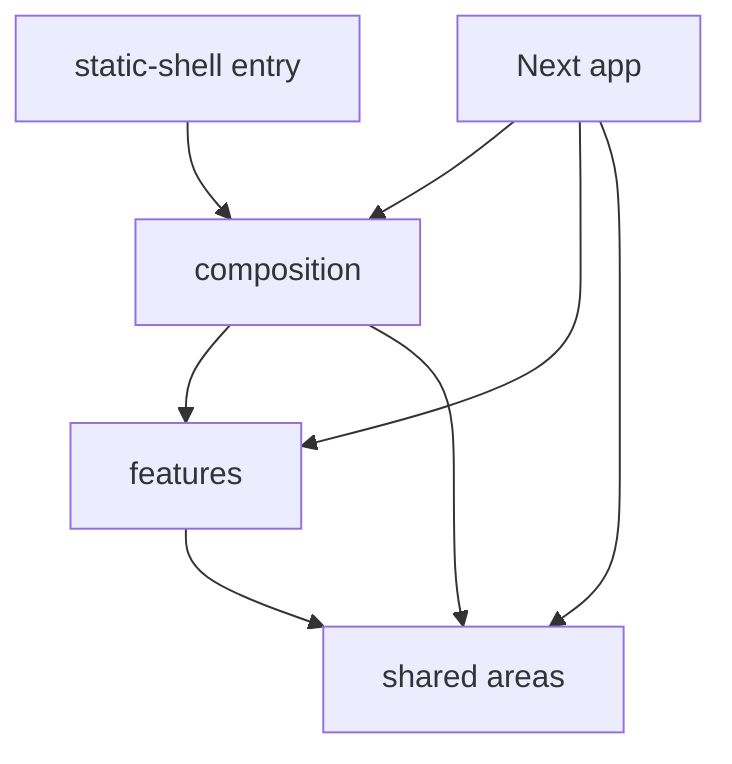

# Angmoo Frontend Architecture

English | [한국어](ARCHITECTURE.ko.md)

Angmoo's frontend **groups code by feature and composes collaborating features in higher-level screens**.
This guide explains where to implement features and fixes, what each area owns, and which dependency
directions are allowed. [DESIGN.md](DESIGN.md) defines visual and interaction standards.

The structure draws on the [Bulletproof React project-structure guide](https://github.com/alan2207/bulletproof-react/blob/master/docs/project-structure.md)
and its [Next.js App Router example](https://github.com/alan2207/bulletproof-react/tree/master/apps/nextjs-app).
Angmoo separates features into `features`, product-screen assembly into `composition`, and shared code into
`assets/components/config/hooks/lib/stores/styles/types/utils`.

## How Angmoo applies the reference structure

| Reference principle | Angmoo's implementation | What is not adopted |
| --- | --- | --- |
| Organize by feature | `src/features/chat`, `memory`, `social`, and other features own their requests, presentation, and state | Collecting every feature in shared components and hooks |
| Compose collaborating features at a higher level | `composition/screens` connects callbacks and slots from different features | Direct feature-to-feature imports or reverse dependencies on screens |
| Keep dependencies from features to shared code one-way | Screens use features; features use shared code: screen → feature → shared area | World, authorization, or provider decisions inside product-neutral primitives |
| Import concrete files and create only useful directories | Import actual role files; use optional `assets`, `stores`, and test support when needed | Mandatory barrel exports, empty directories, or state libraries for every feature |
| Separate App Router entry points | `app` owns Next routes, layouts, and server wiring | Assuming a request-time Next server exists in the installed app |

`composition` is an additional arrangement Angmoo uses to share screens between Next web and static/Tauri
execution. Preserve existing transport, state, Playwright checks, and native wiring instead of copying the
reference project's tool list.

## Contents

- [Current project structure](#current-project-structure)
- [Current feature ownership](#current-feature-ownership)
- [Organizing code within a feature](#organizing-code-within-a-feature)
- [Screen composition and dependency direction](#screen-composition-and-dependency-direction)
- [Sharing screens between web and installed apps](#sharing-screens-between-web-and-installed-apps)
- [API and state ownership](#api-and-state-ownership)
- [Feature state and resource lifetimes](#feature-state-and-resource-lifetimes)
- [Shared UI and design](#shared-ui-and-design)
- [Test support and execution locations](#test-support-and-execution-locations)
- [Adding features and fixing bugs](#adding-features-and-fixing-bugs)
- [Boundary checks and validation scope](#boundary-checks-and-validation-scope)
- [Design references and related documents](#design-references-and-related-documents)

## Current project structure

This tree shows the main tracked paths. Consult each owner's actual tree for omitted files. Shared `stores` and `testing` directories that do not yet exist, and optional feature directories, are described separately rather than presented as current paths.

```text
angmoo/
├── frontend/
│   ├── public/                     # Static files served directly by URL
│   ├── src/
│   │   ├── app/                    # Next.js routes, layouts, metadata, web entry points
│   │   ├── assets/                 # Source assets, including the local Quicksand font
│   │   ├── composition/            # Screens combining features
│   │   │   ├── screens/            # Screens shared by web and static execution
│   │   │   ├── shells/             # Device, World, and Studio frames
│   │   │   ├── providers/          # Authentication, native, and PWA wiring
│   │   │   ├── navigation/         # Product navigation toolbar
│   │   │   ├── locales/            # English/Korean text for composed screens
│   │   │   └── static-product-router.tsx
│   │   ├── features/
│   │   │   ├── device-home/
│   │   │   ├── characters/
│   │   │   ├── creator-studio/
│   │   │   ├── social/
│   │   │   ├── relationships/
│   │   │   ├── world-packages/
│   │   │   ├── chat/
│   │   │   ├── memory/
│   │   │   └── ...
│   │   ├── components/             # Product-neutral shared UI
│   │   ├── config/                 # Environment and runtime configuration
│   │   ├── hooks/                  # Shared React hooks
│   │   ├── lib/                    # Shared transport, navigation, desktop wiring
│   │   ├── styles/                 # Required shared styles
│   │   ├── types/                  # Types shared by features
│   │   ├── utils/                  # Shared pure helpers
│   │   └── proxy.ts                # Shared Next-server request-security boundary
│   ├── static-shell/               # Static Next app entry/configuration for installed apps
│   ├── scripts/                    # Static build, preview, Node checks
│   ├── ARCHITECTURE.md
│   ├── DESIGN.md
│   ├── AGENTS.md
│   ├── package.json
│   ├── pnpm-lock.yaml
│   ├── next.config.ts
│   ├── tsconfig.json
│   └── eslint.config.mjs
├── browser-tests/                  # Playwright scenarios, configuration, browser fixtures
└── desktop/                        # Tauri windows, native bridge, installed-app support
```

`app` owns URLs and Next.js concerns. `composition` connects features such as Chat and Memory in one screen. `features` owns feature UI, data requests, and state. Shared areas should not collect code that requires knowledge of a particular domain such as World or Character.

Separate static assets by delivery mechanism and ownership:

- `public/` contains files Next.js serves by URL. For example, `public/images/logo.png` is referenced as `/images/logo.png`. See the [Next.js public convention](https://nextjs.org/docs/app/api-reference/file-conventions/public-folder).
- `src/assets/` contains shared assets referenced through source imports or styles. The current tree uses `src/assets/fonts/quicksand/`.
- `src/features/<feature>/assets/` contains assets referenced in the same way but owned by one feature.

`assets/` is an organizational convention, not a special Next.js directory. It can coexist with `public/`; neither replaces the other. A feature-owned file may live under `public/` when it must be served directly by URL. Documenting both locations is not a reason to move existing files or duplicate assets.

These directories hold repository-owned distribution assets, not user uploads or private media. Placing a file in `assets/` does not make it private. User media follows the existing backend delivery and authorization contracts.

There is currently no shared `src/stores/` directory. It is an optional location for shared client state that does not belong to a feature. Feature-owned state belongs in `src/features/<feature>/stores/`; use by several screens alone does not make it shared infrastructure.

Do not introduce a store or state-management library when component-local state, existing context, or hooks are sufficient.

For example, a basic clickable button belongs in `components`. Using that button to delete a memory and refresh the result belongs in `features/memory`. Authorization and persistence rules for memory deletion belong to the [backend](../backend/ARCHITECTURE.md).

Use filenames that describe responsibilities, such as `world-chat.tsx` or `memory-batch-controls.tsx`. Do not combine unrelated features in one large shared `helpers` file.

### Specific shared-area responsibilities

| Location | Responsibility | Current example or adoption condition |
| --- | --- | --- |
| `app` | URLs, layouts, metadata, Next-server entry points | `app/page.tsx`, `app/memory/page.tsx`, `app/api/` |
| `composition/screens` | Product screens combining features | `world-chat-screen.tsx`, `memory-workspace-screen.tsx` |
| `composition/shells` | Product viewport, World, and Studio frames | `product-viewport.tsx`, `world-app-shell.tsx` |
| `composition/providers` | Authentication, environment, native, and PWA lifetimes | `auth-provider.tsx`, `user-environment-provider.tsx` |
| `components` | UI, presentation, and layout without business decisions | `ui/button.tsx`, `media/post-media-grid.tsx` |
| `config` | Shared runtime, model-presentation, and PWA settings | `features.ts`, `generation-profiles.ts`, `pwa.ts` |
| `hooks` | Shared React resource, navigation, and presentation lifetimes | `use-element-visibility.ts`, `use-runtime-media-url.ts` |
| `lib` | HTTP, authentication, runtime, native, i18n, and media wiring | `http/api-request.ts`, `runtime/runtime-config.ts`, `i18n/` |
| `assets` | Shared static assets referenced by source | Currently `fonts/quicksand/`; builds do not download remote fonts |
| `styles` | Shared styles and semantic tokens | `globals.css`, `semantic-tokens.css` |
| `types` | Actual contracts shared by consumers | `user-environment.ts`; not a collection of every feature DTO |
| `utils` | Shared pure conversions | `class-names.ts`, `safe-navigation.ts` |
| Shared `stores` | Optional feature-neutral client state when needed | Currently absent; inspect existing context and `lib/state/` first |
| Shared `testing` | Optional support actually reused by several tests | Currently absent; connect it to existing `browser-tests` and Node checks |

`lib/server` may hold web-server utilities, but shared screens, Client Components, and static paths must
not import them directly or indirectly. Being in a shared directory does not make code usable in every
runtime. Do not put domain screens or feature handling in `proxy.ts` either.

## Current feature ownership

These features exist in the current `features/` tree. Each row locates an owner, not a scaffolding template.
Confirm the inventory against current directories and callers.

| Feature | Owned functionality and state | Current starting paths |
| --- | --- | --- |
| `identity` | Login, Local sessions, user-environment wiring | `api/session.ts`, `controllers/local-entry-controller.ts` |
| `device-home` | World list, execution surfaces, Home state | `api/device-home-client.ts`, `components/`, `hooks/` |
| `worlds` | World definitions, current-user membership, deletion state | `api/world-app-client.ts`, `api/world-deletion.ts` |
| `characters` | Character creation, profiles, World character settings, activity presentation | `api/`, `components/`, `stores/`, `utils/` |
| `creator-studio` | Character and World creation features | `components/creator-studio-dashboard.tsx` |
| `social` | Feed, posts, replies, reactions, notifications | `components/social-post-row.tsx`, `hooks/use-owner-reactions.ts` |
| `chat` | Threads, messages, sending, streaming, older-history queries | `components/world-chat.tsx`, `hooks/use-world-chat-history.ts` |
| `memory` | Memory queries, review settings, evidence inspector | `components/memory-workspace.tsx`, `api/memory-client.ts` |
| `relationships` | Relationship queries, graph presentation, feature state | `api/`, `components/relationship-graph-frame.tsx` |
| `media` | Photo preparation, selection, recognition, shared image-settings UI | `components/image-picker.tsx`, `workers/photo-preparation.worker.ts` |
| `runtime-status` | Runtime readiness, limitations, diagnostics presentation | `api/runtime-status-client.ts`, `components/` |
| `world-packages` | World package validation, export/import UI, delivery | `api/world-package-client.ts`, `api/browser-delivery.ts`, `api/native-delivery.ts` |
| `tree` | Tree board screens, requests, presentation contracts | `api/`, `components/`, `types/` |
| `support` | Support screens and documents, including API guides and licenses | `api/documents-server.ts`, `components/angmoo-api-content.tsx` |
| `ui-foundation` | Actual rendering fixtures for semantic UI | `components/semantic-foundation-fixture.tsx` |

Ownership of World APIs does not make `worlds` the home for Chat/Feed composition. World screens are
assembled in `composition/screens/world-app.tsx` and related screens. The `relationships` graph component
is also wired inside the current World screen; its name does not imply a required separate native Graph window.

## Organizing code within a feature

Choose directories according to the feature's size and actual responsibilities. This Chat tree is illustrative; it does not claim every file currently exists. Create each directory, including `assets` and `stores`, only when its role is needed.

```text
features/chat/
├── api/                 # Chat endpoints, requests/responses, stream interpretation
├── assets/              # Optional static assets owned by Chat
├── components/          # Chat screens, message lists, composer
├── hooks/               # Chat UI state and request lifecycles
├── types/               # Chat request, response, and view contracts
├── utils/               # Pure conversions used only by Chat
├── stores/              # When a separate state store is actually needed
└── __tests__/           # Feature tests connected to a real test runner
```

| Location | Contains | Owned elsewhere |
| --- | --- | --- |
| `api` | Endpoints, request serialization, response checks, feature-specific errors and stream events | Screen layout, shared session/runtime interpretation |
| `assets` | Feature-owned images, fonts, and other source-referenced static assets | Shared assets; storage/delivery of uploads and private media |
| `components` | Visible screens, inputs, event wiring | Authoritative permission checks, scheduler/provider execution policy |
| `hooks` | React lifetimes: loading, selection, cancellation, unsubscribe | Pure conversions independent of React |
| `types` | Feature DTOs and component contracts | Every type from unrelated features |
| `utils` | Helpers producing the same result from the same input | Hidden API calls, persistence, permission changes |
| `stores` | Client state genuinely shared by several consumers | A second source of truth for server state or unnecessary global state |
| `config` | Fixed presentation and model-selection configuration for the feature | Runtime secrets and business authorization |
| `locales` | The feature's English and Korean catalogs | Translating user content or collecting every other feature's copy |
| `controllers` | Feature-state lifetimes that must also be managed outside React | Global product initialization; inspect Identity's Local-entry controller as a current example |
| `workers` | Browser-worker processing owned by the feature | Backend scheduling/activity execution; Media photo preparation is a current example |

Small features may need only `api`, `components`, and `types`. Local selection state does not require another state library. As code grows, split files within the same responsibility instead of repeating new abstraction layers in every feature.

For example, changing a memory-schedule label starts in `features/memory/components`. An incorrect request payload points to the same feature's `api` and `types`. A frontend hook does not decide when scheduled work executes.

Current Chat directories include `api/components/config/hooks/locales/types/utils`. Do not interpret the
illustrative `assets/stores/__tests__` entries as required current Chat directories. Identity uses `controllers`;
Media uses `workers`. The reference's seven directories are not an exclusive allowlist. Choose roles based
on ownership, actual consumers, and execution lifetime.

## Screen composition and dependency direction

The arrows below show allowed import directions. Shared areas are the `assets`, `components`, `config`, `hooks`, `lib`, `stores`, `styles`, `types`, and `utils` directories directly under `src/`. Shared code does not know features; features do not know their consuming screens.



Do not import directly between features; `import type` follows the same boundary. A screen that uses both imports them separately and connects props, callbacks, or slots. Directly reading another feature's internal state makes small changes require coordinated edits across both features.

`composition/screens/world-chat-screen.tsx` imports Chat, Memory, and Media, then supplies rendering
functions through Chat's `WorldChatViewSlots` contract. This attaches the evidence inspector and image
picker without making Chat import peer features.

This is **an excerpt of two slots in the current implementation**. The complete screen also provides
`renderImagePicker`; the excerpt is not a replacement for the original source file.

```tsx
import type { WorldChatViewSlots } from "@/features/chat/types/view-slots";
import { MemoryScopeSummary } from "@/features/memory/components/memory-scope-summary";
import { WorldChatEvidenceInspector } from "@/features/memory/components/world-chat-evidence-inspector";

const renderMemorySummary: WorldChatViewSlots["renderMemorySummary"] =
  input => <MemoryScopeSummary {...input} />;

const renderEvidenceInspector: WorldChatViewSlots["renderEvidenceInspector"] =
  input => (
    <WorldChatEvidenceInspector
      key={`${input.worldId}:${input.threadId}`}
      {...input}
    />
  );
```

`WorldChatViewSlots` defines callback inputs and `ReactNode` results. Composition supplies concrete
components; Chat supplies current selection, open state, request, and thread state. Changing World/thread
also requires actual request cancellation and scope checks. A React `key` alone does not validate server
permissions or cancel already accepted work.

Import concrete feature files. Do not require a `public.ts` or aggregate `index.ts` intermediary. A screen may use `@/features/chat/components/world-chat`; `features/chat` must not import `features/memory` or `composition` in return.

Do not move business types into shared `types` solely to pass an import check. Decide whether features genuinely share a contract or whether the composing screen should adapt one feature's output to another's input.

## Sharing screens between web and installed apps

Angmoo supports Next.js web execution and static execution in the installed app. Tauri development can use a Next dev server, so not every Tauri run is a static build.

| Execution path | Actual setup | Screen-code considerations |
| --- | --- | --- |
| Docker/Termux browser | Next dev in development Docker; Next server in release Docker/Termux | `app` wires URLs, layouts, and web-only server behavior |
| Windows Host Tauri development | The official wrapper reuses Docker development services and connects a native window | Does not start the installed-app sidecar separately |
| Installed Tauri app/static preview | Bundled HTML/CSS/JS and a client router | Must not assume a request-time Next server |

The [web configuration](next.config.ts) uses `output: "standalone"`; the separate [static-shell configuration](static-shell/next.config.ts) uses `output: "export"`. The [static build script](scripts/build-static.mjs) builds static-shell, moves it to `frontend/out`, and prepares HTML fallbacks for dynamic URLs. Do not replace this structure with one export setting for the entire Next app.

`composition/screens` holds screens used by both entry points. `composition` is Angmoo's organizational choice to reduce duplicated screens and reverse references to Next route files, not a Tauri requirement. Next routes and the static router call the same screens.

Keep Next.js `page.tsx`, `layout.tsx`, metadata, and request-time server code in `app`. Components requiring state, events, or browser APIs need an appropriate Client Component boundary. `"use client"` does not make module-top-level `window` access safe; connect browser-only access to the actual execution lifetime. See [Next.js server and client boundaries](https://nextjs.org/docs/app/getting-started/server-and-client-components).

Server Components can run at build time even with static export. The restriction is on Next-server behavior required for each request in the installed app. Shared screens must not depend on `next/headers`, server secrets, Node filesystem access, or request-time Server Actions. Use existing FastAPI APIs and shared transport for server work. See [Next.js static export](https://nextjs.org/docs/app/guides/static-exports).

New screens must handle direct entry, reload, back navigation, and unsupported paths in the static router. Resolve API addresses, sessions, media URLs, Tauri capabilities, and native commands in shared wiring instead of guessing them in each component.

## API and state ownership

Support owns the server-only loader for the English `docs/agent_guide.md` and Korean
`docs/agent_guide.ko.md` sources. The existing `/agent_guide.md` HTTP route defaults
to Korean; `?lang=en` selects English, and unsupported language values fail.
Next tracing and static asset copying include both source files. Packaging a
document does not add the Next-only API guide screen to static/Tauri.

A feature's `api` knows what to request; shared `lib` transport knows how to send it in the current runtime. Do not implement the same request separately for web and installed apps.

```text
UI event
  → feature component/hook
  → feature API and types
  → shared transport
  → owning FastAPI domain
  → response/error/stream applied to feature state
```

The [World Chat client](src/features/chat/api/world-chat-client.ts) validates feature responses and World scope, then uses shared runtime transport. Preserve URLs, methods, errors, NDJSON events, request IDs, and retry semantics when moving code. Transport cleanup does not justify bypassing session or CSRF handling with a new `fetch` implementation.

Distinguish server data, UI selection state, and persisted user settings. A nearby component can own a collapsed panel or in-progress input. Data and requests belonging to a World, Character, or thread retain that scope. Change saved settings through existing APIs and update the screen from their responses.

Loading, empty, forbidden, not found, degraded, and error are different states. Do not turn failed requests into empty arrays or counts of 0 and display success. Hiding a button helps the UI but does not establish authorization. The backend also validates memory deletion, visibility, and consent to provider costs.

Late responses are part of state management. Cancel requests and unsubscribe on World changes and unmount. Compare results that can arrive after cancellation against the current scope and request. When moving hooks, check for duplicate requests, event subscriptions, or additional provider execution.

## Feature state and resource lifetimes

These contracts apply the structure above to actual features. This section is not a list of implementation progress or historical test outcomes.

### Authentication, environment, and shutdown lifetimes

Identity owns the local-session controller; composition's AuthProvider connects it once. Do not duplicate
preparation requests whenever a screen opens. Distinguish explicit connection stop from transient network
failure, and reject late session responses by generation and scope. A client ID is not an authentication credential.

Environment synchronization sends the current language, time zone, and user settings under existing
contracts. Retry typed busy/503 responses only within allowed time and attempt limits. Check response
ordering so older results cannot overwrite newer environment settings. Initial environment confirmation
must not silently translate stored user or World names.

Changes to user, runtime, World, Character, or thread, and unmount, require cancellation, unsubscribe, and
timer cleanup. Responses may arrive after abort, so compare scope and request identity as well. Accepted
server work has a different lifetime from UI observation; leaving a screen does not prove storage or generation failed.

Full app shutdown follows existing native/backend drain contracts. Closing a child window or browser tab,
logging out, and stopping the backend are different actions. The owning feature provides confirmation for
unsaved input; the shared navigation guard connects it.

### Chat messages and reading position

`useWorldChatHistory` owns one message collection, the contiguous-confirmation cursor, cancellation, and reading intent.

- Initial entry loads the latest 50 messages; older history uses before pages. Automatic and manual loads must not duplicate each other.
- When prepending messages, anchor to the item and screen position being read **when the response arrives**.
- New messages must not force a jump to the bottom while the user reads older history. Provide a new-message indicator and a way to return to the latest messages.
- Preserve intent to follow the latest conversation through new responses, resizing, IME changes, and image-height changes. Preserve the reading position if the user moves into history.
- Merge the two committed messages and evidence summary by ID. Do not reload the entire conversation or use the collection's maximum ID as the contiguous-confirmation cursor.
- Automatic catch-up on focus, online, and visibility events fetches at most 2 after pages per event. Continue remaining gaps explicitly; do not skip intermediate messages from another tab.
- Preserve visible history and the draft when older-history loading fails. Retry only the query.

Request acceptance, streaming, terminal state, and message persistence are distinct. Normal waiting uses
one Typing indicator, cleared by actual delta, terminal state, or scope termination. Evidence details
distinguish the stored projection from current access checks; do not invent missing historical snapshots.

### World Feed and notifications

Feed keeps pages of 30 root posts. Failed additional loads leave existing rows and the composer mounted.
Refresh replaces the page chain only after successfully receiving a new first page.

Committed posts and replies refresh only the relevant root summary. If storage succeeds but summary
fetching fails, offer a query retry. Likes use server count, viewer state, and reaction revision, with per-item
sequences rejecting stale responses. Propagate committed reactions across tabs in the same auth/runtime
scope; consumers verify World and actor identity.

Preserve reading position when inserting posts or changing image heights. Stop image-status queries for
offscreen items when appropriate, without cancelling actual server generation. Read current state when an item becomes visible again.

World notifications retain user and World scope. Display read status and unread counts from committed
server responses. Clean up bounded polling and refresh when auth/runtime scope ends. Failed queries must
not appear as 0 notifications or initiate new Activity.

### Retrieval preparation and detailed diagnostics

Preparation for visible, authenticated Chat checks saved settings and coalesces duplicate requests. Opening
Home/Feed does not pre-create retrieval workers or call providers. Preparation is distinct from search
execution, index readiness, and memory hits; it must not become a mandatory UI gate that blocks Chat input.

Diagnostics distinguish selected paths, actual FTS/vector execution, preparation, embedding, final validation,
failures, and missing records. Do not display an unmeasured duration as 0ms or a timeout as empty. Distinguish
date interpretation from actual search filters. Do not add parent/child or parallel stages and label the sum
as total latency or database-lock hold time.

Memory ON/OFF, key status, retrieval-data readiness, and relationship review use their own saved values and
capabilities. An unsaved key input is not ready. Rechecking or discarding failed memory experiences is
different from deleting original Chat/SNS content; show current scope and actual processed counts.

### Images, settings, and World lifetimes

`useElementVisibility` uses the actual scroll viewport and a callback ref. `useRuntimeMediaResource` starts
authenticated fetches near the viewport, aborts on source/auth/runtime changes, and releases owned blob
URLs. Preserve existing avatar/composer consumption. General hooks do not own World permissions or provider execution rules.

Chat/Feed reserve image space before downloading and provide English/Korean retry guidance on failure.
Distinguish local photo preparation, upload, recognition, generation, storage, and display. Recognition failure
preserves the draft and preview and offers supported explicit retry or photo removal. Photo preparation alone
does not send Chat, create a post, or call AI.

Media settings distinguish saved-key presence, query failure, and CAS conflict. Switching services does not
restore a plaintext key. Distinguish ordinary ComfyUI server connectivity from Partner authentication, and
display JSON as safe text.

Distinguish World deletion acceptance, progress, failure, completion, and status-query failure. Clean up late
responses and subscriptions for the deleted scope. UI convenience does not justify deleting another World,
the original source, or global settings. Package export transfers initial configuration; it is not a full conversation/memory backup.

## Shared UI and design

[DESIGN.md](DESIGN.md) defines color, spacing, typography, accessibility, and state presentation. This guide defines code placement and wiring. The documents have different responsibilities.

Shared `components` holds buttons, dialogs, surfaces, and product-neutral layouts usable by several features. A shared primitive does not decide which features a World exposes, who may edit memories, or which native window to open. Pass values and callbacks decided by the feature or higher-level screen.

CSS modules move with their owning components. Shared styles use existing semantic tokens; reorganizing folders is not a redesign. Product, Studio, and Memory windows/viewports, relationships inside a World, safe areas, scroll ownership, focus, and keyboard behavior are product contracts. `ProductViewport` and shared frames connect actual dimensions and scroll ownership; their names do not imply that a fixed phone outline should be added.

Images and icons in `public/` and shared/feature `assets/`, static-build asset copying, local fonts, and design fixtures are also consumers. Moving source imports while leaving asset paths or the visual harness behind can break only one execution path.

Shared UI follows [DESIGN](DESIGN.md) for semantic tokens, focus, 44px touch targets, and safe areas.
Keep CSS modules with their components and check attribution/notices for external source, images, and fonts.
General UI uses system fonts; only the approved Home wordmark uses local Quicksand.

Update English and Korean catalogs together for web guidance, errors, placeholders, and accessible names.
Fixed Termux terminal guidance is English and does not follow the web locale. Raw service output and user
content are not translation targets.

## Test support and execution locations

`src/testing` is not currently tracked. It is an optional location for support genuinely reused by several tests, not a mandate to move all tests or automatically introduce a runner.

| Location | Responsibility |
| --- | --- |
| Feature-adjacent tests or `__tests__` | Feature tests and feature-local fixtures, when connected to an actual runner |
| `src/testing/data-generators.ts` | Synthetic data generation reused by several tests |
| `src/testing/mocks` | Reusable transport and platform substitutes |
| `src/testing/test-utils.tsx` | Shared rendering/provider helpers when needed |
| `src/testing/setup-tests.ts` | Setup/cleanup registered in the actual runner configuration |
| `../browser-tests` | Current Playwright web, static, and visual scenarios; server/browser-specific fixtures |
| `scripts/test-world-package-proxy.mjs` | Current Node-based proxy contract checks |

The referenced [frontend dependency manifest](package.json) does not include Vitest, React Testing Library, or MSW, and there are no tracked tests in `frontend/e2e`. A directory or helper file does not prove a test executes. Define consuming tests, configuration, commands, and CI wiring together if a new tool is needed. Do not install the reference example's library list wholesale.

Device Home's shared validation consumers already connect to backend source-contract tests, Playwright fixtures in `browser-tests`, and frontend Node proxy checks. Add shared React-rendering helpers or mock servers when several feature tests actually reuse them, together with runner registration.

Fixtures depending on Playwright `Page`/`Route` or a Node server belong in that execution project. Distinguish reusable synthetic data from runner-specific helpers. Clean up mocks, timers, subscriptions, and shared state between tests.

Product `app`, `composition`, `features`, and shared code do not import test-only support. Tests and support may reference the system under test or its providers; current boundary checks distinguish product and test support. A test convenience path must not enter the product bundle or bypass feature boundaries.

Existing `ui-foundation` is a screen fixture wired to routes and the visual harness. Do not assume it is a shared test helper and move it into `testing`. Preserve its noindex, exclusion from product navigation, and visual-validation contracts.

## Adding features and fixing bugs

Locate changes by screen and symptom. These are current owners; confirm exact filenames and callers in the feature table and source.

| Change or symptom | Starting point | Related contract |
| --- | --- | --- |
| Memory schedule labels, inputs, errors | `features/memory/components`, related `api/types` | Existing consent, scope, failure states, actual responses |
| Selection wiring between Chat and Memory inspector | `composition/screens` and feature callbacks | No selections/responses left over from another World |
| Duplicate Chat sends or lingering streams | Chat hooks/API and shared transport subscribe/cancel paths | Request IDs, retries, NDJSON, backend state |
| Dialog focus problems across screens | Shared `components` and DESIGN | Feature behavior, keyboard, scroll |
| Web works but direct URLs fail in the installed app | Static router, shared navigation, static-shell | Path interpretation, fallbacks, supported capabilities |
| API authorization error | Feature API error handling and the owning backend domain | Actual scope/permissions; no UI bypass |

For example, displaying a saved schedule in the existing Memory screen follows this sequence:

1. Inspect existing backend responses and errors, then connect the feature's types and API.
2. Show loading, absent, failed, and saved states in Memory components. Do not fabricate state by guessing server values.
3. Compose Memory presentation in a higher-level screen if another feature's screen needs it. Do not make the features import each other.
4. Compare states using existing browser-fixture responses and assertions. Check static execution as well for a shared screen.

If the backend response or feature semantics must change, also review [backend architecture](../backend/ARCHITECTURE.md) and the feature contract. Moving UI structure alone does not change APIs or user behavior.

## Boundary checks and validation scope

In the current [frontend boundary policy](../security/frontend_architecture_policy.json), `refactor.complete=true` selects complete structural checking
that discovers the actual `src` and `static-shell/app` trees. Do not infer that a new feature is absent from
the policy file's historical feature list alone.

| Boundary | Rule |
| --- | --- |
| Between features | No direct imports, type imports, or re-exports; connect through higher-level composition |
| Shared areas | No reverse references to features, app, composition, or static entry points |
| Shared screens/static paths | No direct or indirect imports from Next `app` or server-only utilities |
| Import resolution | Static-string dynamic imports are checked; do not hide boundaries behind computed module paths |
| Retired paths | Do not recreate old `shared` or feature `ui/model/public` paths as new roles |
| Product/tests | Product bundles do not import test helpers |

Use the [path-mapping record](../security/refactor_path_map.json) as a lookup aid for older names, not as a folder template for new work or proof
of feature success. The checker's actual inputs and ownership rules are defined by the
[complete frontend boundary implementation](../scripts/ci/frontend_completed_boundaries.py).

### Development environment and relevant checks

[CONTRIBUTING.md](../CONTRIBUTING.md) owns environment setup and supported execution steps. The official contributor environment uses two Docker Compose services: Next dev and FastAPI. Use the wrapper in the [Windows Host Tauri guide](../docs/public/windows-host-tauri-dev.md) for native-window checks. Do not mix the installed sidecar with the development Docker backend.

Run frontend checks in the official development environment from the repository root:

```powershell
docker compose -f compose.yml -f compose.dev.yml exec -T frontend pnpm lint
docker compose -f compose.yml -f compose.dev.yml exec -T frontend pnpm typecheck
docker compose -f compose.yml -f compose.dev.yml exec -T frontend pnpm build
```

Hosts with the repository's required tools and dependencies can also use the commands below. Select checks relevant to the move; small changes do not require repeating every execution path.

```powershell
pnpm --dir frontend lint
pnpm --dir frontend typecheck
pnpm --dir frontend test:world-package-proxy
pnpm --dir frontend build
pnpm --dir frontend build:static

uv run --project backend python scripts/ci/check_frontend_architecture_boundaries.py
uv run --project backend python scripts/ci/check_frontend_design_contract.py --check
```

Browser-test collection varies by the [actual configuration and command](../browser-tests/package.json). Follow the contributor guide for dependencies and Playwright Chromium installation.

| Command — from the repository root | Scope and prerequisites |
| --- | --- |
| `pnpm --dir browser-tests test` | Web-shell and relationship-graph scenarios matching `product-shell.spec.ts`; not every browser check |
| `pnpm --dir browser-tests test:ui-e-local-settings` | Scenarios from the separate local-settings configuration |
| `pnpm --dir browser-tests exec playwright test --config playwright.static.config.ts` | Static scenarios; requires `frontend build:static` first |
| `pnpm --dir browser-tests test:visual` | Next and static projects in the visual configuration; check both builds and CI's fixed image/font baseline |

If `src/testing` support is added, wire its consuming tests, collection configuration, setup, and CI execution. An unchanged test count after a move does not prove assertions or product behavior are preserved. A successful web build does not validate static routing, native windows, or the installed app.

Structural moves should explain old and new paths for APIs, state, UI, assets, and tests. Use synthetic data and substitutes for feature regressions. Record real provider quality and installed-app user checks as separate evidence.

Required remote checks follow the [CI guide](../docs/operations/ci-validation.md). This is not an instruction
to run the entire app suite for every documentation edit. Actual frontend code/design changes follow the
directory's AGENTS instructions, boundary/design checks, lint, typecheck, and relevant affected-scope validation.

## Design references and related documents

- [Bulletproof React — Project Structure](https://github.com/alan2207/bulletproof-react/blob/master/docs/project-structure.md): reference for feature organization, shared areas, direct file imports, and higher-level composition.
- [Next.js App Router example](https://github.com/alan2207/bulletproof-react/tree/master/apps/nextjs-app): an example of assigning responsibilities in App Router. Its libraries and directories are not Angmoo's mandatory inventory.
- [DESIGN.md](DESIGN.md), [design references](../docs/architecture/frontend-design-reference.md), [product shell](../docs/architecture/frontend-product-shell.md): actual screen, asset, navigation, and window boundaries.
- [Backend Architecture](../backend/ARCHITECTURE.md): API, authorization, persistence, and job-lifetime ownership.
- [Contribution map](../docs/public/contribution-map.md), [current product architecture](../docs/public/architecture.md): feature and execution-path navigation.
- [Frontend migration record](../docs/architecture/refactor-frontend-results.md): historical validation/merge evidence for earlier work. Check current code rules and new-release validation separately.

This guide defines implementation locations and wiring rules. Structural checks, feature regressions,
real AI quality, and installed-app/physical-device user checks are distinct evidence; historical completion
statements do not replace them.
